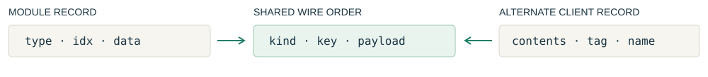

.. _datum-in-practice:

.. _a-sales-pitch-for-programmers:

.. rst-class:: datum-in-practice

Psst... wanna buy a codec?
==========================

Ceph data arrives in pieces. Send a split payload to a consumer, retain it in a native
bufferlist, select the missing bytes of a cached read, or build a listing range. Datum gives
these jobs a shared vocabulary that works with ordinary C++23 storage and algorithms.
The examples below show the operations, their results, and the plumbing they can replace.

In the examples, ``datum`` abbreviates ``ceph::salad::datum`` and ``iv`` abbreviates its
``interval`` namespace.

Reading across separate buffers
-------------------------------

.. rst-class:: datum-lead

A seven-byte payload is split across two buffers, followed by a four-byte trailer. The consumer
accepts the payload in chunks and uses each chunk during the call:

.. code-block:: cpp

   const std::array fragments {"pay"sv, "load"sv, "tail"sv};
   const std::size_t length = 7;

.. raw:: html

   <figure class="datum-byte-flow" aria-label="Original buffers, borrowed spans, and the consumer">
     

       
<strong>Original buffers</strong>
payloadtail · unread

       
       
<strong>Borrowed slice</strong>
3-byte span → pay4-byte span → load

       
       
<strong>Consumer calls</strong>
1. pay2. load

     

     <figcaption>The spans point to the original bytes. Keep those buffers alive while the consumer uses them.</figcaption>
   </figure>

.. list-table::
   :class: datum-code-comparison
   :widths: 50 50

   * - **Before · join, then select**

       .. code-block:: cpp

          std::string contiguous;
          datum::append_range(contiguous, fragments | std::views::join);
          const auto payload = std::string_view {contiguous}.substr(0, length);
          consume(payload);

       .. rst-class:: datum-annotation

       Join the buffers, then select the payload.

       `Complete comparison in the PR <https://github.com/chardan/ceph/blob/jfw-datum/doc/dev/radosgw/datum/in-practice-assets/fragment-example.cc>`_.
     - **After · select, then consume**

       .. code-block:: cpp

          datum::byte_cursor input {fragments};
          const auto payload = input.take(length);
          datum::write_fragments(payload, consume);

       .. rst-class:: datum-annotation

       Select seven bytes, then pass their original spans to the consumer.

       PR implementation: `take <https://github.com/chardan/ceph/blob/jfw-datum/src/rgw/datum/include/datum/bytes.h>`_ ·
       `write_fragments <https://github.com/chardan/ceph/blob/jfw-datum/src/rgw/datum/include/datum/bytes.h>`_.

The staging version uses ``<datum/range.h>``: ``views::join`` exposes the characters
across the fragments, and ``append_range`` appends them to the string. The view itself
does not copy; appending creates the contiguous copy. The same call works with native
C++23 range insertion and with standard libraries still missing that member.

``take(7)`` checks that seven bytes are available and advances the cursor. The slice covers
``pay`` and ``load``; it leaves ``tail`` unread. No joining buffer is needed. Keep the fragment
range and its bytes alive while using the slice.

.. rst-class:: datum-takeaway

Seven bytes, two consumer calls, and the trailer stays unread.

For an ordinary contiguous destination, one call copies the selected bytes:

.. code-block:: cpp

   std::array<char, 7> output {};
   datum::copy(fragments, 0, output);

The output size supplies the byte count. Use ``byte_extent {offset, length}`` when
only part of a larger output should be written. Both capacities are checked before
writing. With ``<ceph-datum.h>``, the same call accepts a native ``buffer::list``.

.. _start-with-ceph-buffers:

Keep Ceph's buffers, choose the ownership
-----------------------------------------

The same payload can stay in native Ceph storage. Include ``<ceph-datum.h>`` and use an
ordinary ``buffer::list`` built from two ``buffer::ptr`` segments:

.. literalinclude:: in-practice-assets/fragment-example.cc
   :language: cpp
   :start-at:     ceph::buffer::list reply;
   :end-at:     reply.append(ceph::buffer::copy("loadtail", 8));
   :dedent: 4

Copy the seven payload bytes into an ordinary array, across that native segment boundary:

.. literalinclude:: in-practice-assets/fragment-example.cc
   :language: cpp
   :start-at:     datum::copy(reply, 0, output);
   :end-at:     datum::copy(reply, 0, output);
   :dedent: 4
   :prepend: std::array<char, 7> output {};

The destination supplies the byte count. To keep a native result instead, choose whether it
shares the source payload or owns independent bytes:

.. list-table::
   :class: datum-code-comparison
   :widths: 50 50

   * - **Before · assemble the native results**

       .. literalinclude:: in-practice-assets/fragment-example.cc
          :language: cpp
          :start-at:     ceph::buffer::list native_retained;
          :end-at:     native_independent.append(std::move(native_bytes));
          :dedent: 4

       ``substr_of`` retains references. Creating a new payload and copying into it makes
       an independent result.
     - **After · name the ownership choice**

       .. literalinclude:: in-practice-assets/fragment-example.cc
          :language: cpp
          :start-at:     const datum::byte_extent payload {0, 7};
          :end-at:     const ceph::buffer::list independent = datum::copy(reply, payload);
          :dedent: 4

       The same ``byte_extent`` selects both results. ``slice`` retains native references;
       ``copy`` returns independent payload bytes.

Both lists remain valid after ``reply.clear()``. A retained slice shares potentially mutable
bytes and follows Ceph's native storage ownership rules. Choose the independent copy when
later changes to shared bytes must not affect the result.

Like a ``std::span`` subspan, the slice selects existing bytes without copying their
payload. A span borrows one contiguous region; this result is another ordinary
``ceph::buffer::list`` whose segment handles retain the selected payloads, even across
segment boundaries. For Ceph-owned buffers, those references keep the bytes alive
independently of the source list. Externally backed buffers retain their native
lifetime obligations.

.. rst-class:: datum-takeaway

Choose ownership with a verb. Keep the native bufferlist either way.

The same native list can feed the pure core through a standard view of spans:

.. literalinclude:: in-practice-assets/fragment-example.cc
   :language: cpp
   :start-at:     const auto native_fragments = datum::fragments(retained);
   :end-at:     datum::copy(native_fragments, output);
   :dedent: 4

Keep ``retained`` and the view descriptor alive while iterating. The iterator depends on
the descriptor; a span already obtained from it needs only its backing bytes to remain alive.
``fragments`` borrows the list and exposes its segments without concatenating their payload
into a staging buffer. Native types stay in ``ceph-datum.h``, while the core consumes standard
storage and ranges.
Here the retained list contains only the payload, so ``copy(source, output)`` copies
its complete contents without a separate offset or byte count.

:download:`The complete program <in-practice-assets/fragment-example.cc>` checks both sides of
the comparison, retained storage, independent copying, and the fragments bridge. Link a Ceph
target with ``datum::core`` and ``datum::ceph``; the :doc:`Ceph vocabulary lesson's setup
<build-and-run>` gives the standalone build paths for an existing Ceph-common library.
The operations shown here use C++23.

Selecting a key range
---------------------

.. rst-class:: datum-lead

An object listing starts with a prefix. Start and end markers narrow that range before the database
scans it. Start with the eight ``names`` below. Add a start marker, then an end marker;
the C++ code changes with the selected keys. Cross the markers to get an empty range.

.. raw:: html

   

     
Build the range. Watch the code and its selection change.

     

       <button aria-pressed="true" aria-controls="datum-key-code datum-key-results" class="step active" data-stage="0" type="button" disabled>1. Prefix</button>
       <button aria-pressed="false" aria-controls="datum-key-code datum-key-results" class="step" data-stage="1" data-start="photos/20" type="button" disabled>2. Add a start marker</button>
       <button aria-pressed="false" aria-controls="datum-key-code datum-key-results" class="step" data-stage="2" data-start="photos/20" data-end="photos/80" type="button" disabled>3. Add an end marker</button>
       <button aria-pressed="false" aria-controls="datum-key-code datum-key-results" class="step" data-stage="3" data-start="photos/80" data-end="photos/20" type="button" disabled>Cross the markers</button>
     

     

       
C++23 · select and print the matching names

       <pre aria-labelledby="datum-key-code-label"><code id="datum-key-code">auto selected = datum::key::byte_query::prefix("photos/");

   const auto intervals = iv::compile_intervals&lt;1&gt;(selected);
   std::ranges::for_each(names | std::views::filter([&amp;selected](const auto name) {
       return iv::contains(selected, name);
   }),  { std::println("{}", name); });</code></pre>
     

     

       notes/01
       photos/10
       photos/20
       photos/30
       photos/70
       photos/80
       photos/90
       videos/01
     

     
Selected: photos/10, photos/20, photos/30, photos/70, photos/80, photos/90

   

.. rst-class:: datum-annotation

Object names are shown here; the backend scans their encoded keys.

.. rst-class:: datum-scope

Worked name range, fixed namespace, and exclusive start/end markers. The left expands the
endpoint updates used by the recorded planner; the right uses the library's byte-key vocabulary.

.. list-table::
   :class: datum-code-comparison
   :widths: 50 50

   * - **Before · maintain endpoint state**

       .. code-block:: cpp

          auto selection = select_for(prefix_scan(query), row_limit);
          if (selection.begin_key <= marker_key) {
              selection.begin_key = marker_key;
              selection.begin_inclusive = false;
          }
          if (end_key <= selection.end_key) {
              selection.end_key = end_key;
              selection.end_inclusive = false;
          }
          if (selection.end_key <= selection.begin_key) {
              return {};
          }

       .. rst-class:: datum-annotation

       Update bounds and inclusivity, then check for an empty range.

       `Planner source excerpt in the PR docs <https://github.com/chardan/ceph/blob/jfw-datum/doc/dev/radosgw/datum/in-practice-assets/integration-listing.cpp.txt#L8-L64>`_.
     - **After · compose the selection**

       .. code-block:: cpp

          auto selected = datum::key::byte_query::prefix("photos/");
          selected = datum::key::starting_after(selected, "photos/20");
          selected = datum::key::ending_before(selected, "photos/80");

          const auto intervals =
              datum::interval::compile_intervals<1>(selected);

       .. rst-class:: datum-annotation

       Intersect the prefix range with the two bounds. Equal or crossed bounds produce no intervals.

       PR implementation: `bounds operations <https://github.com/chardan/ceph/blob/jfw-datum/src/rgw/datum/include/datum/interval/query.h>`_ ·
       `range compilation <https://github.com/chardan/ceph/blob/jfw-datum/src/rgw/datum/include/datum/interval/query.h>`_.

``compile_intervals<1>`` produces at most one range here: the intersection of the prefix range and
two bounds. A backend adapter maps finite endpoints to the database’s inclusive or
exclusive endpoints and preserves the native query options chosen by the caller.
Such database bindings live with the consumer integration. The runnable example operates on
names directly; a native binding supplies the encoded prefix and markers for a database scan.
Adapters use ``iv::is_finite(endpoint)`` to check a Datum boundary; its provider needs
only ``kind()``, ``key()``, and ``inclusive()`` along with its domain identity.

``key::byte_query`` is the supplied vocabulary for byte-string keys and prefixes.
It is distinct from ``interval::byte_query``, which selects numeric byte positions.

.. rst-class:: datum-takeaway

The listing code chooses the prefix and markers. The range operations calculate the bounds. The
adapter constructs the database selection.

The listing integration excerpt below shows this boundary; database-specific
adapters are outside the foundation library.

.. raw:: html

   

Run the key-range example

The interactive stages show a prefix, one bound, two bounds, and crossed bounds. The
:download:`complete program <in-practice-assets/key-range-example.cc>` applies the ordinary
pair of markers, then shows record ordering. Its first
two output lines are:

.. code-block:: text

   photos/30
   photos/70

:download:`Download the program <in-practice-assets/key-range-example.cc>` or
`read it in the PR <https://github.com/chardan/ceph/blob/jfw-datum/doc/dev/radosgw/datum/in-practice-assets/key-range-example.cc>`_.
From a Ceph checkout, use your C++23 compiler in place of ``c++`` below. The
:doc:`build instructions <build-and-run>` describe the compiler requirements.

.. code-block:: sh

   c++ -std=c++23 -Isrc/rgw/datum/include \
       doc/dev/radosgw/datum/in-practice-assets/key-range-example.cc -o /tmp/datum-key-range
   /tmp/datum-key-range

.. raw:: html

   

Sort records with ordinary Ranges
-------------------------------------

Suppose a listing needs names in ascending order, with the newest generation of each name first.
The records remain ordinary C++ aggregates:

.. literalinclude:: in-practice-assets/key-range-example.cc
   :language: cpp
   :start-at: struct listed_object final
   :end-at: };

The ordering policy has two parts. The explicit comparator spells out the tie handling;
``<datum/compare.h>`` lets us compose those same decisions:

.. list-table::
   :class: datum-code-comparison
   :widths: 50 50

   * - **Before · branch on each tie**

       .. literalinclude:: in-practice-assets/key-range-example.cc
          :language: cpp
          :start-at:     std::ranges::sort(objects,  {
          :end-at:         return lhs.generation > rhs.generation;
          :dedent: 4
          :append: });

       Sort by name, then reverse the generation comparison when the names are equal.
     - **After · compose the keys**

       .. literalinclude:: in-practice-assets/key-range-example.cc
          :language: cpp
          :start-at:     std::ranges::sort(objects, datum::order_by(
          :end-at:         datum::descending(&listed_object::generation)));
          :dedent: 4

       Each projection names a field. The comparison policy stays separate from the records.

``ascending`` and ``descending`` name each field's direction. ``order_by`` supplies
the Boolean predicate expected by ``std::ranges::sort``, consulting the next field only
when the preceding one is equivalent. These conveniences share Datum's comparison
composition machinery. The remaining output shows the tie on ``photos/30`` resolved
by descending generation:

.. code-block:: text

   photos/30@9
   photos/30@2
   photos/70@4

For a single pair field, ``nth_key`` serves as a standard Ranges projection:

.. literalinclude:: in-practice-assets/key-range-example.cc
   :language: cpp
   :start-at:     std::array pairs
   :end-at:     std::ranges::sort(pairs, {}, datum::nth_key<0>);
   :dedent: 4

Use standard tuple ordering when it already describes the policy. These helpers compose
projections of existing records and pairs; the complete key-range program checks both forms.

Reading only the missing bytes
------------------------------

A read asks for bytes 0–63. The cache already holds bytes 16–47. The useful work is the
two gaps: sixteen bytes on each side. Express that directly as requested bytes minus cached bytes:

.. raw:: html

   <figure class="datum-cache-gaps" aria-label="Requested bytes 0 through 63, cached bytes 16 through 47, and two missing ranges">
     
Requested

0–63 · 64 bytes

     
Already cached

16–47 · 32 bytes

     
Still needed

0–1548–63

     <figcaption>Two gaps of sixteen bytes. Thirty-two logical bytes still need to be read.</figcaption>
   </figure>

Ceph’s `write-log read path <https://github.com/ceph/ceph/blob/dc7b747c37c466b46bfd90bd7b940b8cdf3c8478/src/librbd/cache/pwl/AbstractWriteLog.cc#L740-L775>`_
handles this problem when it separates cache hits from the gaps still needed from storage.
This small example isolates that range calculation for one cached block. Offsets named ``stop``
are one past the last byte: 64 for the request and 48 for the cached block. Here, ``iv`` is a short
name for Datum’s interval namespace. Describe the two pieces with the built-in byte geometry:

.. literalinclude:: in-practice-assets/cache-gap-example.cc
   :language: cpp
   :start-at:     const datum::byte_extent wanted
   :end-at:     const iv::byte_query cached = iv::bounds(held);
   :dedent: 4

``bounds`` turns an offset and length into a half-open byte selection. ``wanted`` covers
``[0, 64)`` and ``held`` covers ``[16, 48)``. ``interval::byte_query`` already supplies byte-position
ordering; applications can use it directly.

.. list-table::
   :class: datum-code-comparison
   :widths: 50 50

   * - **Before · branch around the cached block**

       .. code-block:: cpp

          if (wanted_start < cache_start) {
              read(wanted_start, std::min(cache_start, wanted_stop) - wanted_start);
          }
          if (cache_stop < wanted_stop) {
              const auto start = std::max(cache_stop, wanted_start);
              read(start, wanted_stop - start);
          }

       Check for a gap before the cached block and another after it.

       `Complete comparison in the PR <https://github.com/chardan/ceph/blob/jfw-datum/doc/dev/radosgw/datum/in-practice-assets/cache-gap-example.cc>`_.
     - **After · subtract the covered bytes**

       .. code-block:: cpp

          const auto missing = iv::difference(requested, cached);
          for (const auto& part : iv::compile_intervals<2>(missing)) {
              read(part.lower().key(), part.upper().key() - part.lower().key());
          }

       Select the requested bytes that are not cached, then visit the resulting ranges.

       PR implementation: `difference <https://github.com/chardan/ceph/blob/jfw-datum/src/rgw/datum/include/datum/interval/query.h>`_.

The same subtraction handles zero, one, or two missing ranges; ``compile_intervals<2>`` allows
for the two-range case shown here. The program records the resulting reads as
``std::vector<datum::byte_extent>``, using the same vocabulary for requests and results.

Both versions produce:

.. code-block:: text

   read 0..15 (16 bytes)
   read 48..63 (16 bytes)

The cache keeps its buffer ownership and locking. The storage layer still chooses how to issue the
physical reads. This comparison changes only how the logical gaps are calculated.

:download:`Run or inspect the complete cache-gap comparison <in-practice-assets/cache-gap-example.cc>`.

The :doc:`landing page's interactive read planner <index>` extends this calculation to overlapping
requests and multiple cached regions, then limits how much data to read in each batch.

Encoding record fields
----------------------

.. rst-class:: datum-lead

A BI (bucket-index) entry carries a kind, a key, and a payload. The client and module can agree on
those three facts while choosing their own records and containers.

The next two panels are recorded examples from a separate native integration. Their shared
bucket-index codecs belong to that integration. Datum supplies the field selection and optional
Ceph framing machinery; the :doc:`RGW tutorial preview <16-rgw-page>` explains the consumer
bindings and their setup. Explicit field selection, the generic codec, and the native framing
adapter are available in C++23; reflected field discovery is optional.

.. list-table::
   :class: datum-code-comparison
   :widths: 50 50

   * - **Before · a record with its encoder**

       .. code-block:: cpp

          struct rgw_cls_bi_entry {
            BIIndexType type = BIIndexType::Invalid;
            std::string idx;
            ceph::buffer::list data;

            void encode(ceph::buffer::list& bl) const {
              ENCODE_START(1, 1, bl);
              encode(type, bl);
              encode(idx, bl);
              encode(data, bl);
              ENCODE_FINISH(bl);
            }
            // Other members omitted.
          };

       .. rst-class:: datum-annotation

       The native record defines its wire encoding.

       `Native record at the recorded revision <https://github.com/ceph/ceph/blob/dc7b747c37c466b46bfd90bd7b940b8cdf3c8478/src/cls/rgw/cls_rgw_types.h#L494-L523>`_.
     - **After · a record and a field list**

       .. code-block:: cpp

          struct entry final
          {
              BIIndexType type = BIIndexType::Invalid;
              std::string idx;

              ceph::buffer::list data;
          };

          constexpr auto module_entry_fields =
              datum::binary_fields<&entry::type,
                  &entry::idx, &entry::data> {};

       .. rst-class:: datum-annotation

       ``&entry::type`` names the ``type`` member of ``entry``. The three member pointers list the fields
       in wire order.

       `Record and field-list excerpts in the PR docs <https://github.com/chardan/ceph/blob/jfw-datum/doc/dev/radosgw/datum/in-practice-assets/integration-bi.cpp.txt#L8-L21>`_ ·
       `binary_fields in the PR <https://github.com/chardan/ceph/blob/jfw-datum/src/rgw/datum/include/datum/record.h>`_.

``binary_fields`` lists which members the codec should visit, in which order. The adapter supplies
the field encodings and Ceph framing. Pass that field list to the shared entry-sequence codec:

.. code-block:: cpp

   auto candidate = cls::rgw::bi_wire::encode_entries(
       module_entry_fields, value.entries, value.is_truncated);
   output.claim_append(candidate);

.. rst-class:: datum-takeaway

One entry codec can serve native records, independent module records, and client-defined rows.

.. rst-class:: datum-source

Native version-one entry format. Selected source excerpts; other record members omitted.
`Reply encoder excerpt <https://github.com/chardan/ceph/blob/jfw-datum/doc/dev/radosgw/datum/in-practice-assets/integration-bi.cpp.txt#L42-L75>`_ · `field traversal in the PR <https://github.com/chardan/ceph/blob/jfw-datum/src/rgw/datum/include/datum/codec/zpp.h>`_.

.. raw:: html

   

What happens inside this call?

A member pointer names a field in a type. Combine it with a record to access that field:

.. code-block:: cpp

   const auto field = &entry::idx;
   const auto& name = value.*field;  // refers to the same string as value.idx

For the field list above, the chosen fields are ``type``, ``idx``, and ``data``, in that order.
The public field list works in C++23. Its implementation expands the selected member pointers
with a short-circuit fold:

.. literalinclude:: ../../../../src/rgw/datum/include/datum/codec/zpp.h
   :language: cpp
   :start-at:     auto result = success;
   :end-at:     return result;
   :dedent: 4

``value.*Member`` accesses the selected field, and ``serialize_field`` invokes its codec.
The fold stops when a field reports failure. With native C++26 reflection enabled, the
implementation expresses the same walk with an expansion statement:

.. literalinclude:: ../../../../src/rgw/datum/include/datum/codec/zpp.h
   :language: cpp
   :start-at:         template for (constexpr auto member : members)
   :end-before:         return serialization_detail::success;
   :dedent: 8

``template for`` expands the loop at compile time. Both paths visit fields in the approved wire
order, borrow the archive and record, and stop at the first error. The application uses the same
``binary_fields`` selection and codec call in either dialect.

`Read the complete function in the PR <https://github.com/chardan/ceph/blob/jfw-datum/src/rgw/datum/include/datum/codec/zpp.h>`_.

.. raw:: html

   

Choosing a reply container
--------------------------

.. rst-class:: datum-lead

The existing client has a list-based reply. The shared wire decoder can also fill a vector,
including rows whose member names and declaration order differ.

.. list-table::
   :class: datum-code-comparison
   :widths: 50 50

   * - **Before · the reply type chooses a list**

       .. code-block:: cpp

          struct rgw_cls_bi_list_ret {
            std::list<rgw_cls_bi_entry> entries;
            bool is_truncated;
            // Other members omitted.
          };

          // Successful receive path:
          rgw_cls_bi_list_ret op_ret;
          auto iter = out.cbegin();
          decode(op_ret, iter);

          entries->swap(op_ret.entries);
          *is_truncated = op_ret.is_truncated;

       .. rst-class:: datum-annotation

       The public reply record supplies the destination layout.

       Recorded native source: `reply type <https://github.com/ceph/ceph/blob/dc7b747c37c466b46bfd90bd7b940b8cdf3c8478/src/cls/rgw/cls_rgw_ops.h#L885-L903>`_ ·
       `client receive path <https://github.com/ceph/ceph/blob/dc7b747c37c466b46bfd90bd7b940b8cdf3c8478/src/cls/rgw/cls_rgw_client.cc#L306-L317>`_.
     - **After · an alternate row and a vector**

       .. code-block:: cpp

          struct client_row
          {
              ceph::buffer::list contents;
              std::uint8_t tag;
              std::string name;
          };

          constexpr auto client_row_fields =
              datum::binary_fields<&client_row::tag,
                  &client_row::name, &client_row::contents> {};

          auto result = wire::decode_entries<
              std::vector<client_row>>(client_row_fields, cursor);

       .. rst-class:: datum-annotation

       Select tag, name, contents. Decode directly into ``vector<client_row>``.

       PR docs: `alternate-row fixture <https://github.com/chardan/ceph/blob/jfw-datum/doc/dev/radosgw/datum/in-practice-assets/integration-bi.cpp.txt#L352-L360>`_ ·
       `shared wire codec <https://github.com/chardan/ceph/blob/jfw-datum/doc/dev/radosgw/datum/in-practice-assets/integration-bi.cpp.txt#L81-L346>`_.

The alternate row above comes from the wire tests. The ordinary client keeps its native entry type
and offers both list and vector routes:

.. code-block:: cpp

   auto [candidate, is_truncated] = bi_datum::decode_reply<EntriesT>(out);
   destination->swap(candidate);
   *truncated = is_truncated;

.. rst-class:: datum-annotation

Both client versions publish after decoding. The shared decoder adds the choice of destination.
`List/vector client excerpt in the PR docs <https://github.com/chardan/ceph/blob/jfw-datum/doc/dev/radosgw/datum/in-practice-assets/integration-bi.cpp.txt#L366-L404>`_.

Integration checks
------------------

The native boundary comes with concrete Ceph mechanisms: reference-counted payloads,
advancing bufferlist iterators, and native short-read errors. Here are two useful compositions
from the same runnable program. They use ``<ceph-datum.h>`` and standard storage.

Borrow one segment, gather across a boundary
~~~~~~~~~~~~~~~~~~~~~~~~~~~~~~~~~~~~~~~~~~~~

A parser often needs one contiguous field, even when its input is a bufferlist. Always copying
into scratch works; borrowing an existing contiguous segment can avoid that payload copy:

.. list-table::
   :class: datum-code-comparison
   :widths: 50 50

   * - **Before · always fill scratch**

       .. code-block:: cpp

          std::array<char, 7> scratch {};
          auto input = retained.cbegin();
          input.copy(7, scratch.data());
          const std::span<const char> field {scratch};

       The native iterator copies across any segment boundaries.
     - **After · let the storage choose the path**

       .. literalinclude:: in-practice-assets/fragment-example.cc
          :language: cpp
          :start-at:     std::array<char, 7> scratch {};
          :end-at:     const auto gathered = datum::read_contiguous(fragmented_input, scratch);
          :dedent: 4

       The same operation borrows one segment when possible, or gathers exactly seven bytes.

For ``retained``, the payload crosses two native segments, so the result points into ``scratch``.
For the independent list created earlier, its payload is already contiguous:

.. literalinclude:: in-practice-assets/fragment-example.cc
   :language: cpp
   :start-at:     auto contiguous_input = independent.cbegin();
   :end-at:     const auto borrowed = datum::read_contiguous(contiguous_input, scratch);
   :dedent: 4

That result points directly into the native payload. Both cursors advance by seven bytes.
Short input throws ``ceph::buffer::end_of_buffer`` before consuming any bytes. Keep the
source list alive for a borrowed result, or scratch alive for a gathered result; scratch must
not overlap unread input. The complete program checks both pointer paths and short-read progress.

Object positions meet native storage
~~~~~~~~~~~~~~~~~~~~~~~~~~~~~~~~~~~~

A packed reply may hold object bytes ``[4096, 4103)`` at list offset zero. Select three bytes at
object offset 4098, translate the selection, and keep it as another native bufferlist:

.. literalinclude:: in-practice-assets/fragment-example.cc
   :language: cpp
   :start-at:     const datum::byte_mapping stored
   :end-at:     assert(piece.to_str() == "ylo");
   :dedent: 4

The result is ``ylo``, spanning both original segments while sharing their payload storage.
``clip`` carries the logical extent and adjusted backing offset together. No local interval
domain, cursor adapter, or buffer wrapper is needed. :doc:`Bytes with a Ceph accent <18-ceph-bytes>` develops this coordinate mapping.

.. rst-class:: datum-takeaway

Describe the bytes once; choose how each component observes or retains them.

The :download:`runnable native comparison <in-practice-assets/fragment-example.cc>` checks these
compositions alongside copying and retained storage. The
`native vocabulary tests <https://github.com/chardan/ceph/blob/jfw-datum/src/test/rgw/datum_ceph.cc>`_
also exercise mutation of shared payloads and checked output bounds.

Optional `Ceph framing <https://github.com/chardan/ceph/blob/jfw-datum/src/rgw/datum/adapters/ceph/wire.h>`_
uses native frame headers and bounds, while the
`RGW key wire profile <https://github.com/chardan/ceph/blob/jfw-datum/src/rgw/datum/adapters/rgw/key.h>`_
keeps name and instance fields in their reviewed wire order. These adapters and the buffer
operations above use C++23. Consumer integrations check their complete wire
compatibility, truncated replies, and publication after successful decoding in their own suites.

Sources
-------

Library code in the PR
~~~~~~~~~~~~~~~~~~~~~~

`Range bounds <https://github.com/chardan/ceph/blob/jfw-datum/src/rgw/datum/include/datum/interval/query.h>`_ · `range compilation <https://github.com/chardan/ceph/blob/jfw-datum/src/rgw/datum/include/datum/interval/query.h>`_

`Native Ceph vocabulary <https://github.com/chardan/ceph/blob/jfw-datum/src/rgw/datum/adapters/ceph-datum.h>`_ ·
`byte geometry and queries <https://github.com/chardan/ceph/blob/jfw-datum/src/rgw/datum/include/datum/interval/metric.h>`_ ·
`comparison composition <https://github.com/chardan/ceph/blob/jfw-datum/src/rgw/datum/include/datum/compare.h>`_

`Byte cursor and fragment writer <https://github.com/chardan/ceph/blob/jfw-datum/src/rgw/datum/include/datum/bytes.h>`_

`Field selection <https://github.com/chardan/ceph/blob/jfw-datum/src/rgw/datum/include/datum/record.h>`_ · `selected-field codec <https://github.com/chardan/ceph/blob/jfw-datum/src/rgw/datum/include/datum/codec/zpp.h>`_

Integration source excerpts
~~~~~~~~~~~~~~~~~~~~~~~~~~~

The panel links open current library code in the Datum PR or native code at recorded revisions.
The integration excerpts retain their source revision, filename, and original line ranges.
The listing excerpt uses the current shared boundary predicate; its planner range includes
the complete final function. The source notes identify these presentation adaptations:

- :download:`Listing planner and database adapter <in-practice-assets/integration-listing.cpp.txt>`.
- :download:`Bucket-index records, codec, client, and test fixture <in-practice-assets/integration-bi.cpp.txt>`.

The :doc:`first tutorial <01-hello-fragments>` uses the same byte operations. The
:download:`complete split-buffer comparison <in-practice-assets/fragment-example.cc>` contains
the staging, borrowing, native Ceph copying, retained slices, and fragments bridge shown here.

Comparison scope
~~~~~~~~~~~~~~~~

The BI panels compare native Ceph code with the independent binding. The alternate client row is a
real wire-test fixture. Success-path excerpts omit surrounding error handling.

Listing panel: equivalent explicit endpoint updates for the stated finite case, alongside named
operations from the current planner and adapter. The recorded adapter maps the resulting intervals to backend endpoint options.

The split-buffer and native-buffer comparisons are standalone uses of the library API.
Their input is eleven bytes; both split-buffer versions deliver the first seven as ``payload``.
The browser's key demo evaluates its fixed ASCII names from the same bounds used to render the
C++23 code. Each displayed stage is checked against the real Datum implementation; the browser
does not execute C++. The crossed-marker stage has no selected names.

The native binding examples come from a separate integration branch. They are distinct from the
foundation library and its runnable tutorial examples.

The :download:`source revisions and hashes <in-practice-assets/source-notes.json>` identify the
comparison inputs. Native integration tests and their recorded results are outside this
foundation change.
