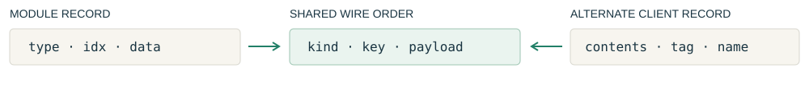
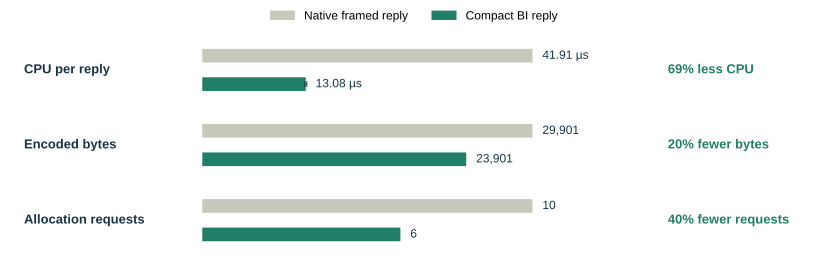

.. _datum-in-practice:

.. _a-sales-pitch-for-programmers:

.. rst-class:: datum-in-practice

Psst... wanna buy a codec?
==========================

Here are real-world examples from gateway bucket listings and the object-class methods that encode
bucket-index replies. Small cache and split-buffer examples show how to select missing bytes and
read a payload across separate buffers.

Selecting a key range
---------------------

.. rst-class:: datum-lead

An object listing starts with a prefix. Start and end markers narrow that range before the database
scans it. For names under ``photos/``, select those after ``photos/20`` and before ``photos/80``.

.. raw:: html

   

A prefix and two markers

   
<button aria-pressed="true" class="step active" data-stage="0" type="button">Prefix photos/</button><button aria-pressed="false" class="step" data-stage="1" type="button">Add start after photos/20</button><button aria-pressed="false" class="step" data-stage="2" type="button">Add end before photos/80</button>

   
notes/01photos/10photos/30photos/70photos/90videos/01

   
Selected: photos/10, photos/30, photos/70, photos/90

.. rst-class:: datum-annotation

Object names are shown here; the backend scans their encoded keys.

.. rst-class:: datum-scope

Finite current-index range, fixed namespace, and encoded name markers. The left expands the right’s
range operations.

.. list-table::
   :class: datum-code-comparison
   :widths: 50 50

   * - **Explicit bounds**

       .. code-block:: cpp

          auto selection = select_for(prefix_scan(query), row_limit);
          if (selection.begin_key <= marker_key) {
              selection.begin_key = marker_key;
              selection.begin_inclusive = false;
          }
          if (end_key <= selection.end_key) {
              selection.end_key = end_key;
              selection.end_inclusive = false;
          }
          if (selection.end_key <= selection.begin_key) {
              return {};
          }

       .. rst-class:: datum-annotation

       Update bounds and inclusivity, then check for an empty range.

       `Planner source excerpt in the PR docs <https://github.com/chardan/ceph/blob/jfw-datum/doc/dev/radosgw/datum/in-practice-assets/integration-listing.cpp.txt#L8-L63>`_.
     - **Datum bounds**

       .. code-block:: cpp

          auto scan = prefix_scan(query);
          scan = datum::key::starting_after(scan, marker_key);
          scan = datum::key::ending_before(scan, end_key);

          const auto intervals =
              datum::interval::compile_intervals<1>(scan);

       .. rst-class:: datum-annotation

       Intersect the prefix range with the two bounds. Equal or crossed bounds produce no intervals.

       PR implementation: `bounds operations <https://github.com/chardan/ceph/blob/jfw-datum/src/rgw/datum/include/datum/interval/query.h#L2705-L2741>`_ ·
       `range compilation <https://github.com/chardan/ceph/blob/jfw-datum/src/rgw/datum/include/datum/interval/query.h#L2074-L2102>`_.

``compile_intervals<1>`` produces at most one range here: the intersection of the prefix range and
two bounds. The adapter maps its endpoints to the database’s inclusive or exclusive endpoints:

.. code-block:: cpp

   auto selection = ceph::libfdb::select(
       endpoint_for(interval.lower()), endpoint_for(interval.upper()));

.. rst-class:: datum-takeaway

The listing code chooses the prefix and markers. The range operations calculate the bounds. The
adapter constructs the database selection.

`Database adapter excerpt in the PR docs <https://github.com/chardan/ceph/blob/jfw-datum/doc/dev/radosgw/datum/in-practice-assets/integration-listing.cpp.txt#L69-L100>`_.

.. raw:: html

   

Run the key-range example

The complete program applies the prefix and both markers to an array of names. It prints:

.. code-block:: text

   photos/30
   photos/70

:download:`Download the program <in-practice-assets/key-range-example.cc>` or
`read it in the PR <https://github.com/chardan/ceph/blob/jfw-datum/doc/dev/radosgw/datum/in-practice-assets/key-range-example.cc>`_.
From a Ceph checkout, use your C++26 compiler in place of ``c++`` below. The
:doc:`build instructions <build-and-run>` describe the compiler requirements.

.. code-block:: sh

   c++ -std=c++26 -Isrc/rgw/datum/include \
       doc/dev/radosgw/datum/in-practice-assets/key-range-example.cc -o /tmp/datum-key-range
   /tmp/datum-key-range

.. raw:: html

   

Reading only the missing bytes
------------------------------

A read asks for bytes 0–63. The cache already holds bytes 16–47. Read the sixteen bytes on each side:

.. raw:: html

   <figure class="datum-cache-gaps" aria-label="Requested bytes 0 through 63, cached bytes 16 through 47, and two missing ranges">
     
Requested

0–63 · 64 bytes

     
Already cached

16–47 · 32 bytes

     
Still needed

0–1548–63

     <figcaption>Two gaps of sixteen bytes. Thirty-two logical bytes still need to be read.</figcaption>
   </figure>

Ceph’s `write-log read path <https://github.com/ceph/ceph/blob/dc7b747c37c466b46bfd90bd7b940b8cdf3c8478/src/librbd/cache/pwl/AbstractWriteLog.cc#L740-L775>`_
handles this problem when it separates cache hits from the gaps still needed from storage.
This small example isolates that range calculation for one cached block. Offsets named ``stop``
are one past the last byte: 64 for the request and 48 for the cached block. Here, ``iv`` is a short
name for Datum’s interval namespace.

.. list-table::
   :class: datum-code-comparison
   :widths: 50 50

   * - **Explicit gap checks**

       .. code-block:: cpp

          if (wanted_start < cache_start) {
              read(wanted_start, std::min(cache_start, wanted_stop) - wanted_start);
          }
          if (cache_stop < wanted_stop) {
              const auto start = std::max(cache_stop, wanted_start);
              read(start, wanted_stop - start);
          }

       Check for a gap before the cached block and another after it.

       `Complete comparison in the PR <https://github.com/chardan/ceph/blob/jfw-datum/doc/dev/radosgw/datum/in-practice-assets/cache-gap-example.cc>`_.
     - **Range subtraction**

       .. code-block:: cpp

          const auto missing = iv::difference(requested, cached);
          for (const auto& part : iv::compile_intervals<2>(missing)) {
              read(part.lower().key(), part.upper().key() - part.lower().key());
          }

       Select the requested bytes that are not cached, then visit the resulting ranges.

       PR implementation: `difference <https://github.com/chardan/ceph/blob/jfw-datum/src/rgw/datum/include/datum/interval/query.h#L1148-L1158>`_.

The program calls its byte-range type ``ByteRange``. ``ByteRange::closed_open(0, 64)`` covers
bytes 0–63. The same subtraction handles zero, one, or two missing ranges; ``compile_intervals<2>``
allows for the two-range case shown here.

Both versions produce:

.. code-block:: text

   read 0..15 (16 bytes)
   read 48..63 (16 bytes)

The cache keeps its buffer ownership and locking. The storage layer still chooses how to issue the
physical reads. This comparison changes only how the logical gaps are calculated.

:download:`Run or inspect the complete cache-gap comparison <in-practice-assets/cache-gap-example.cc>`.

Reading across separate buffers
-------------------------------

.. rst-class:: datum-lead

A seven-byte payload is split across two buffers, followed by a four-byte trailer. The consumer
accepts the payload in chunks and uses each chunk during the call:

.. code-block:: cpp

   const std::array fragments {"pay"sv, "load"sv, "tail"sv};
   const std::size_t length = 7;

.. raw:: html

   <figure class="datum-byte-flow" aria-label="Original buffers, borrowed spans, and the consumer">
     

       
<strong>Original buffers</strong>
payloadtail · unread

       
       
<strong>Borrowed slice</strong>
3-byte span → pay4-byte span → load

       
       
<strong>Consumer calls</strong>
1. pay2. load

     

     <figcaption>The spans point to the original bytes. Keep those buffers alive while the consumer uses them.</figcaption>
   </figure>

.. list-table::
   :class: datum-code-comparison
   :widths: 50 50

   * - **With a staging string**

       .. code-block:: cpp

          std::string contiguous;
          for (const auto fragment : fragments) {
              contiguous.append(fragment);
          }
          const auto payload = std::string_view {contiguous}.substr(0, length);
          consume(payload);

       .. rst-class:: datum-annotation

       Join the buffers, then select the payload.

       `Complete comparison in the PR <https://github.com/chardan/ceph/blob/jfw-datum/doc/dev/radosgw/datum/in-practice-assets/fragment-example.cc#L36-L42>`_.
     - **With a borrowed slice**

       .. code-block:: cpp

          datum::byte_cursor input {fragments};
          const auto payload = input.take(length);
          datum::write_fragments(payload, consume);

       .. rst-class:: datum-annotation

       Select seven bytes, then pass their original spans to the consumer.

       PR implementation: `take <https://github.com/chardan/ceph/blob/jfw-datum/src/rgw/datum/include/datum/bytes.h#L348-L355>`_ ·
       `write_fragments <https://github.com/chardan/ceph/blob/jfw-datum/src/rgw/datum/include/datum/bytes.h#L375-L386>`_.

``take(7)`` checks that seven bytes are available and advances the cursor. The slice covers
``pay`` and ``load``; it leaves ``tail`` unread. No joining buffer is needed. Keep the fragment
range and its bytes alive while using the slice.

Encoding record fields
----------------------

.. rst-class:: datum-lead

A BI (bucket-index) entry carries a kind, a key, and a payload. The client and module can agree on
those three facts while choosing their own records and containers.

.. list-table::
   :class: datum-code-comparison
   :widths: 50 50

   * - **Before · a record with its encoder**

       .. code-block:: cpp

          struct rgw_cls_bi_entry {
            BIIndexType type = BIIndexType::Invalid;
            std::string idx;
            ceph::buffer::list data;

            void encode(ceph::buffer::list& bl) const {
              ENCODE_START(1, 1, bl);
              encode(type, bl);
              encode(idx, bl);
              encode(data, bl);
              ENCODE_FINISH(bl);
            }
            // Other members omitted.
          };

       .. rst-class:: datum-annotation

       The native record defines its wire encoding.

       `Native record at the PR base <https://github.com/ceph/ceph/blob/dc7b747c37c466b46bfd90bd7b940b8cdf3c8478/src/cls/rgw/cls_rgw_types.h#L494-L523>`_.
     - **After · a record and a field list**

       .. code-block:: cpp

          struct entry final
          {
              ::BIIndexType type = ::BIIndexType::Invalid;
              std::string idx;

              ::ceph::buffer::list data;
          };

          constexpr auto module_entry_fields =
              datum::binary_fields<&entry::type,
                  &entry::idx, &entry::data> {};

       .. rst-class:: datum-annotation

       ``&entry::type`` names the ``type`` member of ``entry``. The three member pointers list the fields
       in wire order.

       `Record and field-list excerpts in the PR docs <https://github.com/chardan/ceph/blob/jfw-datum/doc/dev/radosgw/datum/in-practice-assets/integration-bi.cpp.txt#L8-L21>`_ ·
       `binary_fields in the PR <https://github.com/chardan/ceph/blob/jfw-datum/src/rgw/datum/include/datum/record.h#L352-L365>`_.

``binary_fields`` lists which members the codec should visit, in which order. The adapter supplies
the field encodings and Ceph framing. Pass that field list to the shared entry-sequence codec:

.. code-block:: cpp

   auto candidate = ::cls::rgw::bi_wire::encode_entries(
       module_entry_fields, value.entries, value.is_truncated);
   output.claim_append(candidate);

.. rst-class:: datum-takeaway

One entry codec can serve native records, independent module records, and client-defined rows.

.. rst-class:: datum-source

Native version-one entry format. Selected source excerpts; other record members omitted.
`Reply encoder excerpt <https://github.com/chardan/ceph/blob/jfw-datum/doc/dev/radosgw/datum/in-practice-assets/integration-bi.cpp.txt#L42-L75>`_ · `field traversal in the PR <https://github.com/chardan/ceph/blob/jfw-datum/src/rgw/datum/include/datum/codec/zpp.h#L72-L102>`_.

.. raw:: html

   

What happens inside this call?

A member pointer names a field in a type. Combine it with a record to access that field:

.. code-block:: cpp

   const auto field = &entry::idx;
   const auto& name = value.*field;  // refers to the same string as value.idx

For the field list above, the chosen fields are ``type``, ``idx``, and ``data``, in that order.
During normal encoding, the implementation walks this list, named ``members``:

.. literalinclude:: ../../../../src/rgw/datum/include/datum/codec/zpp.h
   :language: cpp
   :lines: 92-97
   :dedent: 8

``template for`` is a C++26 loop expanded at compile time for those member pointers.
``value.*member`` accesses the chosen field. ``serialize_field`` passes it to that field’s codec;
a reported error stops the walk.

`Read the complete function in the PR <https://github.com/chardan/ceph/blob/jfw-datum/src/rgw/datum/include/datum/codec/zpp.h#L72-L102>`_.

.. raw:: html

   

Choosing a reply container
--------------------------

.. rst-class:: datum-lead

The existing client has a list-based reply. The shared wire decoder can also fill a vector,
including rows whose member names and declaration order differ.

.. list-table::
   :class: datum-code-comparison
   :widths: 50 50

   * - **Before · the reply type chooses a list**

       .. code-block:: cpp

          struct rgw_cls_bi_list_ret {
            std::list<rgw_cls_bi_entry> entries;
            bool is_truncated;
            // Other members omitted.
          };

          // Successful receive path:
          rgw_cls_bi_list_ret op_ret;
          auto iter = out.cbegin();
          decode(op_ret, iter);

          entries->swap(op_ret.entries);
          *is_truncated = op_ret.is_truncated;

       .. rst-class:: datum-annotation

       The public reply record supplies the destination layout.

       PR base: `reply type <https://github.com/ceph/ceph/blob/dc7b747c37c466b46bfd90bd7b940b8cdf3c8478/src/cls/rgw/cls_rgw_ops.h#L885-L903>`_ ·
       `client receive path <https://github.com/ceph/ceph/blob/dc7b747c37c466b46bfd90bd7b940b8cdf3c8478/src/cls/rgw/cls_rgw_client.cc#L306-L317>`_.
     - **After · an alternate row and a vector**

       .. code-block:: cpp

          struct client_row
          {
              byte_buffer contents;
              std::uint8_t tag;
              std::string name;
          };

          constexpr auto client_row_fields =
              datum::binary_fields<&client_row::tag,
                  &client_row::name, &client_row::contents> {};

          auto result = wire::decode_entries<
              std::vector<client_row>>(client_row_fields, cursor);

       .. rst-class:: datum-annotation

       Select tag, name, contents. Decode directly into ``vector<client_row>``.

       PR docs: `alternate-row fixture <https://github.com/chardan/ceph/blob/jfw-datum/doc/dev/radosgw/datum/in-practice-assets/integration-bi.cpp.txt#L352-L360>`_ ·
       `shared wire codec <https://github.com/chardan/ceph/blob/jfw-datum/doc/dev/radosgw/datum/in-practice-assets/integration-bi.cpp.txt#L81-L346>`_.

The alternate row above comes from the wire tests. The ordinary client keeps its native entry type
and offers both list and vector routes:

.. code-block:: cpp

   auto [candidate, is_truncated] = bi_datum::decode_reply<EntriesT>(out);
   destination->swap(candidate);
   *truncated = is_truncated;

.. rst-class:: datum-annotation

Both client versions publish after decoding. The shared decoder adds the choice of destination.
`List/vector client excerpt in the PR docs <https://github.com/chardan/ceph/blob/jfw-datum/doc/dev/radosgw/datum/in-practice-assets/integration-bi.cpp.txt#L366-L404>`_.

Tests
-----

.. rst-class:: datum-lead

The checks follow the same things a component author cares about: the bytes peers receive, the data
a caller owns, and the result visible after a failed read.

.. raw:: html

   

<strong>364</strong>focused test cases

<strong>774,435</strong>assertions

<strong>27</strong>test executables

.. rst-class:: datum-scope

Recorded Datum and native object-class gate, 25 October 2026.

.. list-table::
   :class: datum-checks-table
   :widths: 50 50

   * - **Native bytes**

       Version-one BI replies match an independent native oracle. The same bytes decode into the alternate
       row shown above.

       .. rst-class:: datum-source

       ``bi_wire.cc · native frames``
     - **Usable owners**

       Destroy the input envelope, then read the decoded payloads. Their backing storage remains alive.

       .. rst-class:: datum-source

       ``bi_wire.cc · payload owners``

.. list-table::
   :class: datum-checks-table
   :widths: 50 50

   * - **Every truncation**

       Reject every proper truncation of the reply. Reject impossible entry counts before constructing
       rows.

       .. rst-class:: datum-source

       ``bi_wire.cc · bounds checks``
     - **Caller-visible results**

       Client tests cover transport and decode failures. Completed candidates are published only after
       decoding succeeds.

       .. rst-class:: datum-source

       ``bi_client.cc · result publication``

.. rst-class:: datum-takeaway

The BI wire suite alone contains 34 cases and 27,266 assertions.

.. rst-class:: datum-source

The listing fixtures separately exercise prefix and marker bounds, crossed bounds, delimiter
grouping, and residual filtering.

Encoding costs
--------------

.. rst-class:: datum-lead

The binding can keep the native framed entry format or negotiate a compact reply. The compact format
removes repeated entry frames and writes metadata through the shared codec.

.. raw:: html

   
<strong>1,000 BI entries · no payload bytes · encoding only</strong>Native framed reply on pinned main versus compact BI reply · recorded 23 October 2026

.. list-table:: Compact BI reply comparison
   :header-rows: 1
   :widths: 50 25 25

   * - Measure
     - Native framed
     - Compact
   * - CPU per reply (tcmalloc)
     - 41.91 µs
     - 13.08 µs
   * - Encoded bytes
     - 29,901
     - 23,901
   * - Allocation requests (glibc)
     - 10
     - 6

.. rst-class:: datum-annotation

CPU (central processing unit): tcmalloc. Allocation requests: glibc. Each row compares its own unit.

**Same result:** both replies decode to the same 1,000 records and truncation flag.

**Two allocators:** CPU fell by 68.67% with tcmalloc and 69.27% with glibc in twelve paired runs per
allocator.

**Existing peers:** the binding retains framed replies and compact-format negotiation.

.. rst-class:: datum-scope

Local encoding cost for this case. The CPU reductions have descriptive 95% intervals of 68.34–68.99%
and 68.77–69.75%, respectively. These figures measure local reply encoding; gateway request
throughput also includes transport and storage work.

Sources
-------

Library code in the PR
~~~~~~~~~~~~~~~~~~~~~~

`Range bounds <https://github.com/chardan/ceph/blob/jfw-datum/src/rgw/datum/include/datum/interval/query.h#L2705-L2741>`_ · `range compilation <https://github.com/chardan/ceph/blob/jfw-datum/src/rgw/datum/include/datum/interval/query.h#L2074-L2102>`_

`Byte cursor and fragment writer <https://github.com/chardan/ceph/blob/jfw-datum/src/rgw/datum/include/datum/bytes.h#L247-L386>`_

`Field selection <https://github.com/chardan/ceph/blob/jfw-datum/src/rgw/datum/include/datum/record.h#L352-L365>`_ · `selected-field codec <https://github.com/chardan/ceph/blob/jfw-datum/src/rgw/datum/include/datum/codec/zpp.h#L72-L102>`_

Integration source excerpts
~~~~~~~~~~~~~~~~~~~~~~~~~~~

The panel links open code in the Datum PR or native code at its base. The recorded integration
excerpts, included with the documentation, retain their original revision, filename, and line ranges:

- :download:`Listing planner and database adapter <in-practice-assets/integration-listing.cpp.txt>`.
- :download:`Bucket-index records, codec, client, and test fixture <in-practice-assets/integration-bi.cpp.txt>`.

The :doc:`first tutorial <01-hello-fragments>` uses the same byte operations. The
:download:`complete split-buffer comparison <in-practice-assets/fragment-example.cc>` contains
both versions shown here.

Comparison scope
~~~~~~~~~~~~~~~~

The BI panels compare native Ceph code with the independent binding. The alternate client row is a
real wire-test fixture. Success-path excerpts omit surrounding error handling.

Listing panel: equivalent explicit endpoint updates for the stated finite case, alongside named
operations from the current planner and adapter. The recent direct-import migration removed
forwarding headers; it already used Datum underneath them.

The compact-format measurements compare the preserved October 23 benchmark revisions. They are
distinct from the version-one byte-compatibility example. Exact revisions, source hashes, and result
files accompany this document.

The split-buffer panel is a standalone illustration of the library API, rather than a historical
consumer change. Its input is eleven bytes; both versions deliver the first seven as ``payload``.

The native binding examples come from a separate integration branch. They are distinct from the
foundation library and its runnable tutorial examples.

The :download:`recorded BI measurement data <in-practice-assets/bi-costs.json>` supplies the values
in the performance figure. Its source revisions and case are recorded in the data.
The :download:`plot source <in-practice-assets/plot-bi-costs.py>` regenerates the figure with Matplotlib.

The :download:`source revisions and hashes <in-practice-assets/source-notes.json>` identify the
comparison inputs. The :download:`focused test results <in-practice-assets/test-results.json>` list
the 27 executables behind the coverage figures above.
