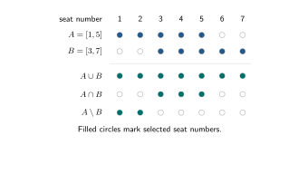
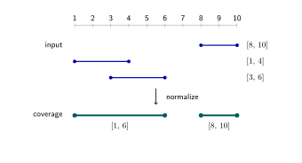
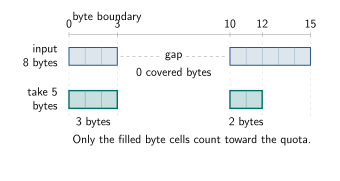
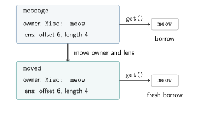
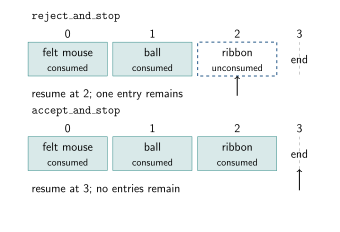

# Datum tutorials

All sections and their examples are provisional while Datum continues to evolve.

Datum provides operations for observing and selecting data, from fragmented bytes
to fields of ordinary records. We will explore them through small C++26 examples,
using standard-library storage and algorithms alongside Datum. Each lesson links
to a complete program and one small variation. The
[build appendix](#appendix-a-building-and-running) gives the setup, build, run,
and output-check commands.
The [index](docs/lookup.md) offers a task finder and short definitions, and the
[bibliography](#bibliography) includes optional background reading.
Select a figure to open it at full size. Chapters 1–15 follow the
[published Datum foundation PR](https://github.com/ceph/ceph/pull/72714);
chapters 16–17 preview a separately pinned RGW integration.

## 1 hello, world! — in pieces

*Read bytes across separate fragments without joining them into one buffer.*

Data often comes in separate buffers. A Datum byte cursor lets us observe a
bounded sequence across those buffers without first gathering them into a string.

The [complete program](examples/01_hello_fragments.cpp) includes `<datum/bytes.h>`
and uses `datum` as a short alias for `ceph::salad::datum`. Our greeting occupies
four fragments:

```cpp
using namespace std::string_view_literals;

const std::array fragments {"hell"sv, "o, w"sv, "orld"sv, "!\n"sv};
```

Construct a cursor over that fragment range and take the fourteen bytes, including
the final newline:

```cpp
// Read all 14 bytes across the fragment boundaries:
datum::byte_cursor input {fragments};
const auto greeting = input.take(14);
```

`take(14)` advances the cursor and returns a slice whose spans refer to the original
bytes. The slice can cross fragment boundaries. A request larger than the remaining
input throws `std::length_error` before advancing the cursor.

Pass those spans to a printing callback:

```cpp
// Send each borrowed span to the output sink:
datum::write_fragments(greeting, [](const auto block) {
    std::print("{}", std::string_view {block});
});
```

`write_fragments` calls the callback synchronously for each span. The temporary
`std::string_view` observes that span's characters; no staging string is needed.
Keep both the fragment range and its backing bytes valid while using the slice.
Here, the array remains in scope, and the bytes belong to string literals.

The output is:

```text
hello, world!
```

### A small variation

Move the fragment boundaries, as in the
[complete variation](examples/01_hello_fragments_variation.cpp):

```cpp
const std::array fragments {"hello, w"sv, "orld!\n"sv};
```

The same cursor operations produce the same output. The greeting and its newline
occupy fourteen bytes regardless of where their physical fragments meet.

### Did you know?

Brian Kernighan used the greeting in a B tutorial published in a January 1973
Bell Labs report. Dennis Ritchie later recalled it as the earliest Hello, World
example that he and Kernighan remembered.
([1](https://www.nokia.com/bell-labs/about/dennis-m-ritchie/btut.html),
[2](https://cm-bell-labs.github.io/who/dmr/bintro.html))

That B example already printed the greeting in pieces: `hell`, `o, w`, and `orld`,
followed by an exclamation mark and a newline together in the last chunk. Our
fragments follow that same division, including the final newline.
([1](https://www.nokia.com/bell-labs/about/dennis-m-ritchie/btut.html))

Kernighan and Ritchie went on to publish *The C Programming Language* in 1978.
([3](https://cm-bell-labs.github.io/who/dmr/chist.html))

## 2 Seat 3 is reserved

*Select an interval of values and exclude a value with interval difference.*

A row has ten seats. We want seats 1–5, except that seat 3 is reserved. Describe
that selection with Datum, then apply it to the row with a standard range filter.

The [complete program](examples/02_seat_selection.cpp) includes
`<datum/interval/query.h>` and uses `iv` as a short alias for `datum::interval`.
An ordered domain tells Datum what its points are and how to compare them.
Datum's `comparison_domain<int>` supplies integer points and their standard
ordering; the named derived type identifies them as seat numbers:

```cpp
// Define the ordered integer domain used by the selection:
struct seat_numbers final : iv::comparison_domain<int> {};
```

Create the row and describe the available seats:

```cpp
const auto seats = std::views::iota(1, 11);

// Select seats 1–5, then exclude the reserved seat:
const auto selection = iv::without(iv::closed_between<seat_numbers>(1, 5), 3);
```

`closed_between` includes both endpoints: seats 1 and 5 are eligible.
`without` expresses set difference by excluding seat 3.
([5](https://raw.githubusercontent.com/chardan/ceph/c22d6be23c73cb113a3d13fea6ba5cd5dfae9cc8/src/rgw/datum/include/datum/interval/query.h))

Test each seat against the selection with `contains(selection, seat)`:

```cpp
// Apply the selection with a standard range filter:
auto available_seats = seats | std::views::filter([&selection](const int seat) {
    return iv::contains(selection, seat);
});

std::println("{:n}", available_seats);
```

The input view supplies seats 1 through 10. The filter keeps those that belong to
the selection; `{:n}` prints the resulting range without outer brackets:

```text
1, 2, 4, 5
```

The same selection can be reused by another consumer that asks whether a seat
belongs. Changing the availability rule leaves the filtering code alone.

### A small variation

Reserve seat 5 instead, as in the
[complete variation](examples/02_seat_selection_variation.cpp):

```cpp
// Select seats 1–5, then exclude the reserved seat:
const auto selection = iv::without(iv::closed_between<seat_numbers>(1, 5), 5);
```

Seat 3 becomes available, and seat 5 is removed:

```text
1, 2, 3, 4
```

## 2½: An Interval Interlude

*Combine seat selections with union, intersection, and difference.*

Return to the numbered seats. An interval describes which points belong between
its boundaries. Square brackets include an endpoint; parentheses exclude it:

| Notation | Meaning for seat numbers |
| --- | --- |
| `[1, 5]` | Include seats 1 through 5. |
| `[1, 5)` | Include seats 1 through 4. |
| `(1, 5)` | Include seats 2 through 4. |
| `[3, 3]` | Select just seat 3: a singleton. |
| `[3, 3)` | Select no seats: an empty interval. |

An interval can also have an unbounded end. The domain supplies ordering, while
the input range supplies the points we actually visit.

The [complete program](examples/02_half_interval_interlude.cpp) uses the same
`seat_numbers` domain as section 2. Make two closed selections:

```cpp
const auto seats = std::views::iota(1, 11);
const auto a = iv::closed_between<seat_numbers>(1, 5);
const auto b = iv::closed_between<seat_numbers>(3, 7);
```

For these selections:

- `set_union(a, b)` includes points in either selection.
- `intersection(a, b)` includes points in both selections.
- `difference(a, b)` includes points in `a` that are absent from `b`; argument order matters.

[](figures/02_half_interval_interlude.svg)

The result rows show union, intersection, and difference. Each filled circle
marks a selected seat number.

For background on half-open integer ranges, see
[Dijkstra's short note on indexing](https://www.cs.utexas.edu/~EWD/transcriptions/EWD08xx/EWD831.html).

Reuse section 2's membership test in a printing lambda defined by this example.
Its arguments are an output label and a selection:

```cpp
// Print member seats; brackets also make an empty selection visible:
const auto print_seats = [&seats](const auto label, const auto& selection) {
    auto selected = seats | std::views::filter([&selection](const int seat) {
        return iv::contains(selection, seat);
    });

    std::println("{}: {}", label, selected);
};
```

Print the input selections, then their combinations:

```cpp
print_seats("A", a);
print_seats("B", b);

// Combine the selections, then test membership in each result:
print_seats("A union B", iv::set_union(a, b));
print_seats("A intersection B", iv::intersection(a, b));
print_seats("A minus B", iv::difference(a, b));
```

Keep `a` and `b` alive while using expressions that refer to them. Here, each
result is consumed synchronously by the printing lambda.
([5](https://raw.githubusercontent.com/chardan/ceph/c22d6be23c73cb113a3d13fea6ba5cd5dfae9cc8/src/rgw/datum/include/datum/interval/query.h))

The output is:

```text
A: [1, 2, 3, 4, 5]
B: [3, 4, 5, 6, 7]
A union B: [1, 2, 3, 4, 5, 6, 7]
A intersection B: [3, 4, 5]
A minus B: [1, 2]
```

### A small variation

Move `b` away from `a`, as in the
[complete variation](examples/02_half_interval_interlude_variation.cpp):

```cpp
const auto b = iv::closed_between<seat_numbers>(7, 9);
```

The intersection is empty, and the union preserves the gap at seat 6:

```text
A: [1, 2, 3, 4, 5]
B: [7, 8, 9]
A union B: [1, 2, 3, 4, 5, 7, 8, 9]
A intersection B: []
A minus B: [1, 2, 3, 4, 5]
```

A selection can cover several separate pieces, as the `without` example already
showed. These operations determine membership; the next lesson prepares ordered,
merged interval coverage for reuse. Ordering alone supplies neither a distance
nor a next value. Section 6 adds a metric when we need to count covered bytes.

## 3 Untangle the ranges

*Merge overlapping intervals and report their coverage in order.*

Three intervals arrive out of order, and two overlap. We want their coverage in
order, with the overlap merged and the gap preserved.

The [complete program](examples/03_normalize_ranges.cpp) uses an integer domain
named `positions`, with the same `int` and `std::compare_three_way` profile as the
seat numbers above. Start with three closed intervals:

```cpp
const std::array ranges {
    iv::closed_between<positions>(8, 10),
    iv::closed_between<positions>(1, 4),
    iv::closed_between<positions>(3, 6)
};
```

Normalize them by constructing a `canonical_set`:

```cpp
// Merge overlaps and put the covered intervals in order:
const iv::canonical_set coverage {ranges};
```

The set owns an ordered collection of intervals, merging overlaps while preserving
the points covered by the input. Here, `[1, 4]` and `[3, 6]` become `[1, 6]`,
followed by the separate interval `[8, 10]`.
([5](https://raw.githubusercontent.com/chardan/ceph/c22d6be23c73cb113a3d13fea6ba5cd5dfae9cc8/src/rgw/datum/include/datum/interval/query.h))

[](figures/03_normalize_ranges.svg)

The [design discussion of canonical operands and evaluation](https://github.com/chardan/ceph/blob/c22d6be23c73cb113a3d13fea6ba5cd5dfae9cc8/src/rgw/datum/README.md#canonical-operands-and-evaluation)
explains how prepared coverage can be reused.

The filled dots mark included endpoints. Print the normalized intervals:

```cpp
for (const auto& interval : coverage) {
    std::println("[{}, {}]", interval.lower().key(), interval.upper().key());
}
```

The output is:

```text
[1, 6]
[8, 10]
```

`lower()` and `upper()` expose each interval's boundaries; `key()` gives the
position of a finite boundary. All the boundaries here are finite and included,
so square brackets describe them accurately. The normalized set can now be reused
for membership tests and further set operations.

### A small variation

Add an interval that bridges the gap, as in the
[complete variation](examples/03_normalize_ranges_variation.cpp):

```cpp
iv::closed_between<positions>(6, 8)
```

It meets the two pieces at their included endpoints. Normalization joins the
coverage into a single interval:

```text
[1, 10]
```

## 4 Put 2 before 10

*Encode integer keys so byte order matches numeric order.*

A store orders keys by their encoded bytes. We want item 2 before item 10, but
ordinary decimal text puts `"10"` before `"2"`. Choose the numeric segment's
encoding explicitly so that key order follows numeric order.

The [complete program](examples/04_numeric_keys.cpp) includes `<datum/key.h>` and
uses `key` as a short alias for `datum::key`. Keep each number alongside its key
so we can print the order after sorting:

```cpp
using keyed_number = std::pair<key::encoded_key, std::uint16_t>;

const std::array<std::uint16_t, 3> numbers {10, 2, 1};
```

Build one collection with decimal segments and another with fixed-width hexadecimal
segments. Both give every key the same first segment, `"item"`:

```cpp
// Decimal segments sort as text:
auto decimal_keys = numbers | std::views::transform([](const auto number) {
    return keyed_number {key::compose("item", key::decimal_segment(number)), number};
}) | std::ranges::to<std::vector>();

// Equal-width hexadecimal segments preserve unsigned numeric order:
auto numeric_keys = numbers | std::views::transform([](const auto number) {
    return keyed_number {key::compose("item", key::fixed_width_hexadecimal_segment(number)), number};
}) | std::ranges::to<std::vector>();
```

`compose` builds an owned key from its segments. The fixed-width encoder writes
hexadecimal digits with the most significant digit first. Its width comes from
the unsigned integer type: our `std::uint16_t` values produce four characters.
Use that same type consistently for numbers in the segment.
([6](https://raw.githubusercontent.com/chardan/ceph/c22d6be23c73cb113a3d13fea6ba5cd5dfae9cc8/src/rgw/datum/include/datum/key.h))

| Number | Decimal segment | Fixed-width hexadecimal segment |
| --- | --- | --- |
| 1 | `"1"` | `"0001"` |
| 2 | `"2"` | `"0002"` |
| 10 | `"10"` | `"000A"` |

`encoded_key` compares its encoded bytes. Sort the pairs by those keys, then print
the associated numbers:

```cpp
// Sort by encoded bytes, keeping each number attached to its key:
std::ranges::sort(decimal_keys, {}, &keyed_number::first);
std::ranges::sort(numeric_keys, {}, &keyed_number::first);

std::println("decimal: {:n}", decimal_keys | std::views::values);
std::println("fixed-width hex: {:n}", numeric_keys | std::views::values);
```

The output shows the order of the actual keys:

```text
decimal: 1, 10, 2
fixed-width hex: 1, 2, 10
```

### A small variation

Try numbers around a hexadecimal digit boundary, as in the
[complete variation](examples/04_numeric_keys_variation.cpp):

```cpp
const std::array<std::uint16_t, 3> numbers {16, 2, 15};
```

The segments for 15 and 16 are `"000F"` and `"0010"`. Their order is preserved
across the change in digits:

```text
decimal: 15, 16, 2
fixed-width hex: 2, 15, 16
```

## 5 Keep the label on the slice

*Clip records to selected intervals and identify the source of each resulting cut.*

Two cats, Miso and Mochi, have supplied a conversation with naps at either end.
Select bytes `[4, 12)` to trim the naps, keeping each piece attached to its speaker's
name. Datum's `clip_view` keeps that source association as it clips the records.

The [complete program](examples/05_labeled_slices.cpp) includes
`<datum/interval/clip.h>`. Its `byte_positions` domain uses `std::size_t` and
`std::compare_three_way`; `interval` names `iv::query<byte_positions>`.
Each ordinary record carries a name, its starting byte position, and its text:

```cpp
struct text_record final
{
    std::string_view name;
    std::size_t offset;
    std::string_view text;
};
```

Create the records and prepare the selection with `canonical_set`:

```cpp
const std::array records {
    text_record {"Miso", 0, "zzz meow"},
    text_record {"Mochi", 8, "purr zzz"}
};
const iv::canonical_set selection {interval::closed_open(4, 12)};
```

These intervals are half-open: the lower endpoint is included, and the upper
endpoint is excluded. The records meet at position 8 without overlapping:

| Record | Extent | Selected part |
| --- | --- | --- |
| `Miso` | `[0, 8)` | `[4, 8)` |
| `Mochi` | `[8, 16)` | `[8, 12)` |

`clip_view` takes the source records, the canonical selection, and a geometry lens.
The lens is a callback that reads one record and returns its byte interval:

```cpp
// Keep the source record attached to each clipped interval:
const iv::clip_view cuts {records, selection, [](const text_record& row) {
    return interval::closed_open(row.offset, row.offset + row.text.size());
}};
```

`clip_view` checks that the records' extents are ordered and disjoint. It produces
separate cuts at record boundaries. Each cut exposes its original record through
`source()` and its selected bounds through `lower()` and `upper()`.
([7](https://raw.githubusercontent.com/chardan/ceph/c22d6be23c73cb113a3d13fea6ba5cd5dfae9cc8/src/rgw/datum/include/datum/interval/clip.h))

Use the cut's global bounds to observe the matching text within its source record:

```cpp
for (const auto& cut : cuts) {
    const auto& record = cut.source();
    const auto lower = cut.lower().key();
    const auto upper = cut.upper().key();

    // Convert global cut bounds to a substring within that source record:
    std::println("{} [{}, {}): \"{}\"", record.name, lower, upper,
                 record.text.substr(lower - record.offset, upper - lower));
}
```

`lower - record.offset` is the starting position within that record's text;
`upper - lower` is the selected byte count. `substr` returns another
`std::string_view`, observing the original characters.

Read each cut's bounds before the iterator advances: they borrow from the iterator
and the selection. Keep the records, selection, and backing text valid, and leave
the records and selection unchanged during traversal. The loop consumes each cut
within those lifetimes.

The output keeps both speakers' names:

```text
Miso [4, 8): "meow"
Mochi [8, 12): "purr"
```

### A small variation

Start the selection exactly at the record boundary, as in the
[complete variation](examples/05_labeled_slices_variation.cpp):

```cpp
const iv::canonical_set selection {interval::closed_open(8, 12)};
```

Miso's record ends at its excluded endpoint, 8, so it contributes no cut:

```text
Mochi [8, 12): "purr"
```

## 6 Five bytes, please

*Use a metric to take up to a quota of covered bytes without counting gaps.*

A byte is "covered" when its position lies inside one of our input intervals.
Here, `[0, 3)` covers byte positions 0, 1, and 2, and `[10, 15)` covers positions 10–14.
The seven positions 3–9 lie in the gap and contribute nothing to the quota.

Take the first five of the eight covered bytes. The gap does not count toward the five-byte quota.

The [complete program](examples/06_covered_quota.cpp) includes
`<datum/interval/metric.h>`. As in the previous lesson, `byte_positions` uses
`std::size_t` with `std::compare_three_way`, and `interval` names
`iv::query<byte_positions>`. Prepare the half-open coverage:

```cpp
// A covered byte has a position inside one of these intervals; gaps consume no quota.
const std::array ranges {
    interval::closed_open(0, 3),
    interval::closed_open(10, 15)
};
const iv::canonical_set coverage {ranges};
```

An ordered domain tells Datum how to compare positions. A metric adds the distance
and arithmetic needed to count bytes and advance a position. Here, byte positions
and byte counts both use `std::size_t`; `unsigned_metric` provides checked unsigned
arithmetic. Pass `take` the canonical coverage, the byte quota, and the metric:

```cpp
const iv::unsigned_metric<std::size_t> byte_metric;
const std::size_t quota = 5;

// Count only covered bytes toward the quota:
const auto selected = iv::take(coverage, quota, byte_metric);
```

`take` selects a prefix of the coverage, bounded by its total measure, and returns
an owning canonical view of the selected intervals. It counts only covered distances, trimming the final
interval when the remaining quota runs out. These metric operations require finite
half-open canonical coverage.
([8](https://raw.githubusercontent.com/chardan/ceph/c22d6be23c73cb113a3d13fea6ba5cd5dfae9cc8/src/rgw/datum/include/datum/interval/metric.h))

[](figures/06_covered_quota.svg)

The selected pieces supply three bytes and two bytes. The gap contributes none.

Use `measure` with the same metric to total the available and selected coverage,
then print each selected interval:

```cpp
std::println("on the menu: {} bytes", iv::measure(coverage, byte_metric));
std::println("order: {} bytes", quota);

for (const auto& span : selected) {
    std::println("[{}, {})", span.lower().key(), span.upper().key());
}

std::println("served: {} bytes", iv::measure(selected, byte_metric));
```

The first interval supplies three bytes. The remaining two come from positions
10 and 11, so the selected second interval ends at its excluded endpoint, 12:

```text
on the menu: 8 bytes
order: 5 bytes
[0, 3)
[10, 12)
served: 5 bytes
```

### A small variation

Ask for ten bytes, as in the
[complete variation](examples/06_covered_quota_variation.cpp):

```cpp
const std::size_t quota = 10;
```

`take` returns all eight available bytes. The quota is an upper limit;
the kitchen has eight:

```text
on the menu: 8 bytes
order: 10 bytes
[0, 3)
[10, 15)
served: 8 bytes
```

## 7 Move it and keep reading

*Keep a string and slice descriptor together so the slice can be recomputed after a move.*

Moving an owner can change where its bytes live. A saved `std::string_view` does
not track that change. Datum's `retained_view` keeps an owner together with a
lens: a description of how to observe part of that owner.

The [complete program](examples/07_retained_slice.cpp) includes `<datum/bytes.h>`
and `<datum/ownership.h>`. Keep Miso's message and select its four-byte reply:

```cpp
// Store the owner together with an offset-and-length lens:
datum::retained_view message {std::string {"Miso: meow"}, datum::byte_slice {6, 4}};
std::println("before move: {}", std::string_view {message.get()});
```

The string owns the characters and is moved into `message`. `byte_slice {6, 4}`
stores an offset and a length. Calling `get()` applies that lens to the retained
string, checks the slice bounds, and returns a borrowed span. The `string_view`
adapts that character span for printing without copying the text.
([9](https://raw.githubusercontent.com/chardan/ceph/c22d6be23c73cb113a3d13fea6ba5cd5dfae9cc8/src/rgw/datum/include/datum/ownership.h),
[10](https://raw.githubusercontent.com/chardan/ceph/c22d6be23c73cb113a3d13fea6ba5cd5dfae9cc8/src/rgw/datum/include/datum/bytes.h))

Move the retained value, then read from its destination:

```cpp
// Move the retained value, then recompute its slice:
const auto moved = std::move(message);
std::println("after move: {}", std::string_view {moved.get()});
```

`retained_view` moves its owner and lens together. It does not cache a span into
the original string: `moved.get()` computes the projection from the destination's
string. Both observations therefore select the same four characters:

```text
before move: meow
after move: meow
```

[](figures/07_retained_slice.svg)

The returned span still borrows from its owner. Use it while that owner remains
alive and unmoved; after a move, request a fresh projection from the destination.
See the [design discussion of geometry and data views](https://github.com/chardan/ceph/blob/c22d6be23c73cb113a3d13fea6ba5cd5dfae9cc8/src/rgw/datum/README.md#geometry-and-data-views)
for the ownership contract. The
[original `span` proposal](https://www.open-std.org/jtc1/sc22/wg21/docs/papers/2018/p0122r7.pdf)
provides historical background on views over separately owned storage.

### A small variation

Change only the slice offset from six to zero, as in the
[complete variation](examples/07_retained_slice_variation.cpp):

```cpp
// Store the owner together with an offset-and-length lens:
datum::retained_view message {std::string {"Miso: meow"}, datum::byte_slice {0, 4}};
```

The same move now preserves the selection of the speaker's name:

```text
before move: Miso
after move: Miso
```

## 8 A window into Miso's toy basket

*Read a record's current field values through a borrowed view.*

A record view can expose named fields without copying their values. Miso's basket
starts with seven toys. Add one toy and read the updated count through the same view.

The [complete program](examples/08_toy_basket.cpp) includes `<datum/record.h>`
and starts with an ordinary record:

```cpp
struct basket_record final
{
    std::string label;
    int toys;
};
```

Create the basket record and a view of it:

```cpp
// Build a borrowed view of the chosen source record:
basket_record basket {"Miso's basket", 7};
const datum::view_of inventory {basket};
```

`view_of` uses C++26 reflection to give `inventory` fields named `label` and `toys`.
The default field projections are const references to the original members:
`inventory.label` observes `basket.label`, and `inventory.toys` observes `basket.toys`.
Constructing the view copies neither the string nor the integer.
([11](https://raw.githubusercontent.com/chardan/ceph/c22d6be23c73cb113a3d13fea6ba5cd5dfae9cc8/src/rgw/datum/include/datum/record.h))

Print through the view, add a toy to the count, and print through the view again:

```cpp
std::println("before: {} holds {} toys", inventory.label, inventory.toys);

// Change the original basket, then observe the view again:
++basket.toys;
std::println("after: {} holds {} toys", inventory.label, inventory.toys);
```

The references provide read-only access, but the source record can still change.
Declaring `inventory` const does not prevent updating `basket` or capture its initial values:

```text
before: Miso's basket holds 7 toys
after: Miso's basket holds 8 toys
```

The view does not own the basket record. The basket record must outlive the view.
`view_of` accepts an lvalue source and rejects a temporary record.

### A small variation

Make a copy first, then view that copy, as in the
[complete variation](examples/08_toy_basket_variation.cpp):

```cpp
const auto snapshot = basket;
const datum::view_of inventory {snapshot};
```

The later increment still updates `basket`, while `inventory` now observes
`snapshot`. Its copied label and toy count retain their earlier values:

```text
before: Miso's basket holds 7 toys
after: Miso's basket holds 7 toys
```

## 9 Pick the basket fields

*Choose record fields and their reading order with a field profile.*

Print the toy count first, then the basket label. A field profile is an ordered
list of members to read. Here, the profile contains `toys` and `label`, leaving out
`capacity`.

The [complete program](examples/09_selected_fields.cpp) includes `<datum/record.h>`
and adds capacity to the familiar basket record:

```cpp
struct basket_record final
{
    std::string label;
    int toys;
    int capacity;
};
```

Name the selected fields and their order:

```cpp
// Select fields in the order the consumer will read them:
using basket_fields = datum::member_fields<&basket_record::toys, &basket_record::label>;
```

The member pointers identify fields of the original record. Their order in the
profile controls observation order, independently of declaration order. Here,
`toys` comes before `label`, and `capacity` is omitted.
([11](https://raw.githubusercontent.com/chardan/ceph/c22d6be23c73cb113a3d13fea6ba5cd5dfae9cc8/src/rgw/datum/include/datum/record.h))

Give the profile to a generic printing function:

```cpp
template <typename FieldsT>
void print_fields(const auto& record)
{

    // Read each selected field through the supplied view:
    FieldsT::observe(record, [](const auto& value) { std::println("{}", value); });
}
```

`observe(record, consumer)` calls the consumer for each selected value of the record,
in profile order. Our void-returning lambda accepts each value by const reference:
first an integer, then a string. The printing function names no basket members.

Use the profile with a view of the basket:

```cpp
const basket_record basket {"Miso's basket", 7, 12};
const datum::view_of inventory {basket};

print_fields<basket_fields>(inventory);
```

The explicit template argument chooses the profile; the function deduces the
source type. Each selected value is printed on its own line:

```text
7
Miso's basket
```

For background on member selection, see
[*Reflection for C++26*](https://www.open-std.org/jtc1/sc22/wg21/docs/papers/2025/p2996r13.html).

### A small variation

Reverse only the profile order, as in the
[complete variation](examples/09_selected_fields_variation.cpp):

```cpp
// Select fields in the order the consumer will read them:
using basket_fields = datum::member_fields<&basket_record::label, &basket_record::toys>;
```

The record, view, and printing function stay the same. The output follows the
new order, still omitting capacity:

```text
Miso's basket
7
```

## 10 Keep your place

*Save an owned resume position when a scan stops before or after consuming an entry.*

Process an inventory list in two passes. The first pass accepts the felt mouse
and ball entries, then stops before consuming the ribbon entry. The second pass
starts with the ribbon.

The [complete program](examples/10_scan_resume.cpp) includes
`<datum/traversal/scan.h>`. Each `toy` entry has an index and a name:

```cpp
const std::array toys {
    toy {0, "felt mouse"},
    toy {1, "ball"},
    toy {2, "ribbon"}
};
```

Each index is a position in the array. Datum provides `scan_range`, which calls
an adapter supplied by the caller to save a position and choose where to resume.
Here, `toy_positions` is example code implementing that contract. Its required
operations are named `position` and `next`:

```cpp
// Datum's position() and next() operations, implemented here for array indices:
struct toy_positions final
{
    std::size_t position(const toy& entry) const { return entry.index; }

    std::size_t next(const std::size_t index, const bool consumed) const
    {
        return consumed ? 1 + index : index;
    }

};
```

Datum calls `toy_positions::position` before the callback; this implementation
copies `entry.index`. If the callback stops, Datum calls `toy_positions::next`
with that saved index and whether the entry was consumed. Our adapter keeps the
index for a rejected entry or returns the following index for a consumed entry.

Datum returns a `scan_result` whose optional `resume` member holds the position
computed by `next`. In this example, `scan.resume` holds the array index by value.
([13](https://raw.githubusercontent.com/chardan/ceph/c22d6be23c73cb113a3d13fea6ba5cd5dfae9cc8/src/rgw/datum/include/datum/traversal/scan.h))

Pass `scan_range` the toy range, an acceptance callback, and `toy_positions`.
The callback prints each offered entry, accepts the first two, and rejects the ribbon:

```cpp
const auto stop = datum::acceptance::reject_and_stop;

// Count offers and consumption, retaining an owned resume index:
const auto scan = datum::traversal::scan_range(toys, [stop](const toy& entry) {
    std::println("offered: {}", entry.name);
    return 2 == entry.index ? stop : datum::acceptance::accept;
}, toy_positions {});
```

An entry is offered when the callback receives it. Returning `accept` counts it
as consumed. Returning `reject_and_stop` stops with the current entry unconsumed,
even though the callback has seen it. The scan returns without advancing the
iterator again.
([12](https://raw.githubusercontent.com/chardan/ceph/c22d6be23c73cb113a3d13fea6ba5cd5dfae9cc8/src/rgw/datum/include/datum/traversal.h))

Report progress, then use the saved index to select the remaining entries.
`std::span::subspan` is a standard-library operation; the loop below is the
example's second pass. Datum returns the position, and the caller uses it:

```cpp
std::println("offered: {}, consumed: {}", scan.progress.offered, scan.progress.consumed);

if (scan.resume) {

    // Apply the saved index to the original array:
    const auto remaining = std::span {toys}.subspan(*scan.resume);
    std::println("resume index: {}", *scan.resume);
    std::println("remaining: {}", std::size(remaining));

    for (const auto& entry : remaining) {
        std::println("resumed: {}", entry.name);
    }
}
```

Three entries were offered, but only two were consumed. Index 2 selects the ribbon
entry again. The array stays unchanged, so its indices still identify the same entries:

```text
offered: felt mouse
offered: ball
offered: ribbon
offered: 3, consumed: 2
resume index: 2
remaining: 1
resumed: ribbon
```

### A small variation

Accept the ribbon entry before stopping, as in the
[complete variation](examples/10_scan_resume_variation.cpp). Change only the
stopping decision:

```cpp
const auto stop = datum::acceptance::accept_and_stop;
```

Now all three entries are consumed. The saved index is 3, the end of the array,
so the remaining range is empty:

```text
offered: felt mouse
offered: ball
offered: ribbon
offered: 3, consumed: 3
resume index: 3
remaining: 0
```

[](figures/10_scan_resume.svg)

The saved index identifies the next entry to consume. The stopping decision
determines whether that is the offered ribbon or the end of the array.

## 11 The discreet log

*Choose which record fields to show, redact, or omit in diagnostic output.*

Print a login record for diagnostics: include Juniper's public name, replace the
password with a redaction marker, and leave out an internal note.

The [complete program](examples/11_discreet_log.cpp) includes
`<datum/render/display.h>`. Its source record is an ordinary struct:

```cpp
struct login_record final
{
    std::string name;
    std::string password;
    std::string internal_note;
};
```

In `ceph::salad::datum::render`, specialize `display_schema` to choose its
diagnostic fields:

```cpp
template <>
struct display_schema<login_record> final
{

    // Approve exactly these diagnostic fields:
    static constexpr auto fields = std::tuple {
        field<&login_record::name>(),
        display_field<&login_record::password, display_field_policy::redacted> {}
    };
};
```

`field` selects the name's value. The password's descriptor instead selects
redaction: its contents are hidden, but its byte count is shown. `internal_note`
has no descriptor and is omitted. Datum infers the record and field labels from
the type and member pointers.
([14](https://raw.githubusercontent.com/chardan/ceph/c22d6be23c73cb113a3d13fea6ba5cd5dfae9cc8/src/rgw/datum/include/datum/render/display.h))

This diagnostic selection is independent of the `member_fields` profile from
section 9. Adding a member to the record does not add it to this explicit tuple.

The specialization chooses the example's policy; Datum supplies the descriptors
and a standard formatter. Print the record with `std::println`:

```cpp
const login_record login {"Juniper", "sesame", "local only"};

// Format the record using its approved diagnostic fields:
std::println("{}", login);
```

The six-byte password contributes only its redaction marker and size:

```text
login_record{name="Juniper", password=<redacted:6 bytes>}
```

### A small variation

Omit the password entirely, as in the
[complete variation](examples/11_discreet_log_variation.cpp). Change only the
schema's field selection:

```cpp
// Approve exactly these diagnostic fields:
static constexpr auto fields = std::tuple {field<&login_record::name>()};
```

Now the password's label and byte count are absent too:

```text
login_record{name="Juniper"}
```

## 12 Send a postcard

*Encode and decode a postcard's recipient and message, excluding its local tracking number.*

Encode a postcard for Juniper. Include its recipient and message, leaving out
the sender's local tracking number.

The [complete program](examples/12_postcard.cpp) includes `<datum/codec/zpp.h>`.
Its record gives the local tracking number a default value:

```cpp
struct postcard final
{
    std::string recipient;
    std::string message;
    int local_id = 0;
};
```

Use `binary_fields` to select the two fields in their encoding order:

```cpp
// Select the transmitted fields and their wire order:
using postcard_wire = datum::binary_fields<&postcard::recipient, &postcard::message>;
```

`postcard_wire` is a Datum schema descriptor. The member pointers select `recipient`
followed by `message`, omitting `local_id`. Datum infers `postcard` from the first
member pointer; this nonempty selection needs no separate record type argument.
The encoder and decoder use the same schema.
([11](https://raw.githubusercontent.com/chardan/ceph/c22d6be23c73cb113a3d13fea6ba5cd5dfae9cc8/src/rgw/datum/include/datum/record.h))
The [design discussion of observation and wire schemas](https://github.com/chardan/ceph/blob/c22d6be23c73cb113a3d13fea6ba5cd5dfae9cc8/src/rgw/datum/README.md#observation-and-wire-schemas)
explains their separate contracts.

Create a postcard, encode it, and decode the resulting bytes:

```cpp
const postcard sent {"Juniper", "wish you were here", 7};

// Round-trip the selected fields; local_id is outside this schema:
const auto bytes = datum::render::to_bytes<postcard_wire>(sent);
const auto received = datum::render::from_bytes<postcard_wire>(bytes);
```

`to_bytes` returns an owning byte buffer. The one-argument `from_bytes` call
constructs and returns a fresh `postcard`: it value-initializes the record, then
decodes the selected fields. The omitted `local_id` keeps its default of zero.
These calls use Datum's optional zpp codec adapter; its setup is in the
[appendix](#enable-the-codec-lesson).
([15](https://raw.githubusercontent.com/chardan/ceph/c22d6be23c73cb113a3d13fea6ba5cd5dfae9cc8/src/rgw/datum/include/datum/codec/zpp.h))

Print the decoded text and compare the sender's local ID with the decoded local ID:

```cpp
std::println("to: {}", received.recipient);
std::println("message: {}", received.message);
std::println("local id: {} -> {}", sent.local_id, received.local_id);
```

The message survives the round trip; the sender's tracking number was not encoded:

```text
to: Juniper
message: wish you were here
local id: 7 -> 0
```

### A small variation

Decode into an existing record, as in the
[complete variation](examples/12_postcard_variation.cpp). Replace the fresh-decoding
line with:

```cpp
postcard received {"old recipient", "old message", 42};
datum::render::from_bytes<postcard_wire>(bytes, received);
```

The two-argument `from_bytes(bytes, received)` decodes into the supplied record.
The selected text is replaced, while the omitted local ID retains its existing
value of 42:

```text
to: Juniper
message: wish you were here
local id: 7 -> 42
```

The codec's error codes are preserved in `std::system_error` exceptions. Trailing bytes are rejected with `std::errc::bad_message`. Decoding into an
existing record can partly update its selected fields before a failure.

## 13 Three tickets

*Charge one work unit before printing each ticket, and refuse tickets beyond the allowance.*

Juniper, Rowan, Hazel, and Wren request tickets, but the allowance is three.
Check and charge the budget before printing each ticket. When the allowance is
exhausted, stop before issuing Wren's ticket.

The [complete program](examples/13_three_tickets.cpp) includes `<datum/budget.h>`.
Set the work allowance and list the visitors:

```cpp
// One work unit pays for one ticket:
datum::resource_budget tickets {{.work = 3}};
const std::array visitors {"Juniper", "Rowan", "Hazel", "Wren"};
```

Here, one unit of `resource::work` represents one ticket. The budget counts the
charges we make explicitly; it does not count operations automatically.

For each visitor, pass `try_charge` the resource kind and the amount to charge:

```cpp
for (const auto visitor : visitors) {

    // Charge before printing, so refusal leaves this ticket unissued:
    if (!tickets.try_charge(datum::resource::work, 1)) {
        std::println("no ticket: {}", visitor);
        break;
    }
    std::println("ticket: {}", visitor);
}
```

`try_charge` returns `true` after adding the charge, or `false` when it would
exceed the allowance or the counter's representable range. Refusal leaves usage
unchanged. Our branch reports the visitor and ends the loop before issuing the
ticket. The separate `charge` operation throws when refusal must abort an operation.
([17](https://raw.githubusercontent.com/chardan/ceph/c22d6be23c73cb113a3d13fea6ba5cd5dfae9cc8/src/rgw/datum/include/datum/budget.h))

Report the cumulative work count:

```cpp
std::println("tickets issued: {}", tickets.used(datum::resource::work));
```

The first three charges succeeded. The refused fourth charge did not spend a unit:

```text
ticket: Juniper
ticket: Rowan
ticket: Hazel
no ticket: Wren
tickets issued: 3
```

### A small variation

Allow four tickets, as in the
[complete variation](examples/13_three_tickets_variation.cpp). Change only the work limit:

```cpp
// One work unit pays for one ticket:
datum::resource_budget tickets {{.work = 4}};
```

All four charges now succeed, and the loop finishes after printing Wren's ticket:

```text
ticket: Juniper
ticket: Rowan
ticket: Hazel
ticket: Wren
tickets issued: 4
```

## 14 Turn the page

*Read a guest list across two pages and retain the next page's index when stopping early.*

Print a four-person guest list stored as two pages. Datum drives the page loop;
we supply how to fetch a page, choose the following page, and visit its entries.

The [complete program](examples/14_turn_page.cpp) includes `<datum/traversal.h>`.
Its two pages are ordinary arrays:

```cpp
const std::array pages {
    std::array {"Juniper", "Rowan"},
    std::array {"Hazel", "Wren"}
};
```

Use array indices 0 and 1 as page positions. The first argument, `std::size_t {0}`,
is the starting position. `for_each_page` then takes three callbacks, in order:

1. **Reader:** receives the current index and returns its page by value.
2. **Next-position callback:** receives the current index and fetched page; returns
   the following index in a `std::optional`, or `std::nullopt` after the last page.
3. **Visitor:** receives the page and returns `page_action::next` or `page_action::stop`.

```cpp
// Visit guest-list pages; return progress and an optional resume index:
const auto result = datum::traversal::for_each_page(
    std::size_t {0},

    // Fetch the page at the current index:
    [&pages](const std::size_t index) { return pages[index]; },

    // Return the following index, or no index at the end:
    [&pages](const std::size_t index, const auto&) -> std::optional<std::size_t> {
        const auto following = 1 + index;

        return std::size(pages) > following ? std::optional {following} : std::nullopt;
    },

    // Print this page and decide whether to keep visiting:
    [](const auto& page) {
        for (const auto guest : page) {
            std::println("guest: {}", guest);
        }

        return datum::traversal::page_action::next;
    });
```

These lambdas supply Datum's callbacks. The next-position callback only needs the
index and array length here, so its page parameter is unused.

The visitor has the same processing role as the function passed to
`std::ranges::for_each`. Datum also uses its return value to control further page visits.

Datum stores the position state by value. The state type must support movement,
assignment, and equality comparison. Each nonterminal next state must compare
unequal to the current state, so traversal makes progress.

Datum computes the following state before calling the visitor, so it can save
that state if the visitor stops. Returning `page_action::next` asks Datum to
continue when another page exists.
([12](https://raw.githubusercontent.com/chardan/ceph/c22d6be23c73cb113a3d13fea6ba5cd5dfae9cc8/src/rgw/datum/include/datum/traversal.h))

Here, `result` is a `page_traversal_result<std::size_t>`. Its `pages` member counts
visited pages, `complete()` reports whether traversal reached the end, and the
optional `resume` member holds a position when traversal stops early:

```cpp
// Report completed page visits and any saved continuation:
std::println("pages: {}", result.pages);
std::println("complete: {}", result.complete());
if (result.resume) {
    std::println("resume index: {}", *result.resume);
}
```

Both pages were visited. Completion leaves no resume position:

```text
guest: Juniper
guest: Rowan
guest: Hazel
guest: Wren
pages: 2
complete: true
```

### A small variation

Stop after visiting one page, as in the
[complete variation](examples/14_turn_page_variation.cpp). Change only the visitor's
return value:

```cpp
return datum::traversal::page_action::stop;
```

The visitor prints Juniper and Rowan, then requests a stop. Datum returns the
ordinary `page_traversal_outcome::stopped` result without fetching the second page.
Its owned resume index is 1, identifying the Hazel/Wren page for a later call:

```text
guest: Juniper
guest: Rowan
pages: 1
complete: false
resume index: 1
```

## 15 Write the order ticket

*Store a byte selection and quota together, then explicitly take up to that many covered bytes.*

Describe a request for bytes `[0, 8)` with a five-byte quota. Datum's planning
interface keeps the selection and an accompanying control value together, so
another part of the program can read and apply them.

The [complete program](examples/15_order_ticket.cpp) includes
`<datum/plan/query.h>` and `<datum/interval/metric.h>`. It reuses the byte-position
profile and metric from section 6. Here, `plan` aliases `datum::plan`, and `iv`
aliases `datum::interval`.

```cpp
// Store the selection and quota without applying the quota:
const auto order = plan::with_control(
    plan::make_query(interval::closed_open(0, 8)), std::size_t {5});
```

`make_query` stores the interval expression. `with_control` returns a new query
containing that expression and the supplied control value. Neither operation
applies the quota.
([18](https://raw.githubusercontent.com/chardan/ceph/c22d6be23c73cb113a3d13fea6ba5cd5dfae9cc8/src/rgw/datum/include/datum/plan/query.h))

Read the selection and retrieve the control by its type:

```cpp
const iv::canonical_set coverage {order.intervals};
const auto quota = plan::control<std::size_t>(order);
const iv::unsigned_metric<std::size_t> byte_metric;

std::println("requested: {} bytes", iv::measure(coverage, byte_metric));
std::println("quota: {} bytes", quota);
```

`control<std::size_t>` retrieves the stored `std::size_t` value. Its type must
identify exactly one control in the query; this example stores just one.
Interpreting that number as a covered-byte quota is this example's convention,
rather than a built-in meaning of integer controls.

The program explicitly applies the quota using the operation from section 6:

```cpp
// This example interprets its size_t control as a covered-byte quota:
const auto selected = iv::take(coverage, quota, byte_metric);
for (const auto& span : selected) {
    std::println("[{}, {})", span.lower().key(), span.upper().key());
}

std::println("served: {} bytes", iv::measure(selected, byte_metric));
```

The request describes eight covered bytes. Applying the five-byte quota returns
the first five:

```text
requested: 8 bytes
quota: 5 bytes
[0, 5)
served: 5 bytes
```

Keeping the request as data lets one part of a program construct it and another
choose how to carry it out. Here, the explicit `take` call supplies that behavior.

### A small variation

In the [complete variation](examples/15_order_ticket_variation.cpp), change only
the stored quota to ten:

```cpp
// Store the selection and quota without applying the quota:
const auto order = plan::with_control(
    plan::make_query(interval::closed_open(0, 8)), std::size_t {10});
```

The selection still contains eight bytes, so `take` returns all eight:

```text
requested: 8 bytes
quota: 10 bytes
[0, 8)
served: 8 bytes
```

## 16 Read an RGW page

*Encode an RGW bucket-list request and decode one reply, including its next marker.*

Request up to two objects under `photos/` from one RGW bucket-index shard.
This lesson introduces the separate RGW integration's request/reply bindings before
the final example combines them with Datum page traversal. These consumer adapters
are outside the Datum foundation PR; the [native setup](#enable-the-native-rgw-examples)
identifies their local source snapshot.

The [complete program](examples/16_rgw_page.cpp) includes
`<rgw/datum/adapters/cls/bucket.h>`. Its `bucket` alias names
`::cls::rgw::bucket_datum`, the RGW-specific adapter. These entry points preserve
Ceph's established message framing and versioned fields. They are the same
bindings used by RGW's bucket-list client in that integration snapshot.
([19](#bibliography),
[21](#bibliography))

An empty `cls_rgw_obj_key` starts the listing. Encode that marker and the request
options, then pass the resulting Ceph buffer list to the example's exchange fixture:

```cpp
const ::cls_rgw_obj_key marker {};

// Request up to two objects under photos/, without delimiter grouping or versions:
const auto request = bucket::encode_request(marker, "photos/", "", 2, false);
const auto response = tutorial_fixture::bucket_page(request);
```

The arguments to `encode_request` are:

| Argument | Meaning here |
| --- | --- |
| `marker` | Start before the first matching entry. |
| `"photos/"` | Match this object-name prefix. |
| `""` | Use no delimiter grouping. |
| `2` | Request at most two returned entries. |
| `false` | Use the non-versioned listing mode. |

`tutorial_fixture::bucket_page` is example support code replacing the live CLS
exchange. It checks the request with RGW's native decoder and constructs a native
reply with Ceph's encoder. The [fixture](examples/fixtures/16_bucket_pages.h)
provides deterministic data; it does not run the server's listing algorithm.

Decode the response with `decode_reply`. Its `flat_entries` template argument
selects the binding's sorted container of owned directory entries:

```cpp
// Decode native directory entries and the server's continuation information:
const auto page = bucket::decode_reply<bucket::flat_entries>(response);
for (const auto& [index_key, entry] : page.dir.m) {
    std::println("object: {}", entry.key.name);
}

std::println("more: {}", page.is_truncated);
if (page.is_truncated) {
    std::println("next marker: {}", page.marker.name);
}
```

`page.dir.m` contains the entries. Print `entry.key.name` for the object name;
the map key is its bucket-index storage key. `page.is_truncated` indicates more
listing work, and `page.marker` is the position to use for the next request.
The marker has the same `cls_rgw_obj_key` type as the request's starting position,
with `name` and `instance` fields. This non-versioned example uses an empty instance.
Both fields are owned strings, so retaining the whole marker preserves its position
without borrowing storage from the decoded page.

Keep the returned marker: filtering can leave a page empty while the server still
advances its position. Inferring continuation from the last returned entry would
lose that information.
([20](#bibliography))

The first reply contains two objects and a continuation marker:

```text
object: photos/ant.jpg
object: photos/bee.jpg
more: true
next marker: photos/bee.jpg
```

### A small variation

In the [complete variation](examples/16_rgw_page_variation.cpp), change only the
starting marker to the position returned above:

```cpp
const ::cls_rgw_obj_key marker {"photos/bee.jpg", ""};
```

The reply contains the remaining object and reports no further work:

```text
object: photos/cat.jpg
more: false
```

The [final example](examples/17_bucket_listing.cpp) combines this request/reply
exchange with section 14's page loop and owned continuation state.

## 17 One shard, two pages

*Read RGW bucket-index pages through native consumer bindings and keep the server's next marker.*

List objects under `photos/` across two pages from one RGW bucket-index shard.
Combine section 16's request/reply bindings with section 14's page traversal.
Ceph's [bucket-index listing notes](https://docs.ceph.com/en/latest/dev/radosgw/bucket_index/#listing)
explain how a full ordered listing combines work across shards.

This chapter uses the separate RGW integration introduced in section 16.
The [complete program](examples/17_bucket_listing.cpp) uses the same
[native reply fixture](examples/fixtures/16_bucket_pages.h) as section 16. The
fixture supplies the CLS responses, so the example runs without a live cluster.

Use short names for the traversal namespace and native marker type:

```cpp
namespace traversal = ::ceph::salad::datum::traversal;
namespace bucket = ::cls::rgw::bucket_datum;

using bucket_marker = ::cls_rgw_obj_key;
```

`bucket_marker` is an alias in this example for the RGW key type introduced in
section 16. Start with an empty marker, then pass the reader, next-position
callback, and visitor from section 14's pattern:

```cpp
const bucket_marker start {};

// Visit CLS listing pages; return progress and an optional resume marker:
const auto result = traversal::for_each_page(
    start,

    // Use the production wire bindings; the fixture supplies the CLS reply:
    [](const bucket_marker& marker) {
        const auto request = bucket::encode_request(marker, "photos/", "", 2, false);
        const auto response = tutorial_fixture::bucket_page(request);

        return bucket::decode_reply<bucket::flat_entries>(response);
    },

    // Resume with the server's marker whenever it reports more work:
    [](const auto&, const auto& page) -> std::optional<bucket_marker> {
        return page.is_truncated ? std::optional {page.marker} : std::nullopt;
    },

    // Read object names from the decoded RGW directory entries:
    [](const auto& page) {
        for (const auto& [index_key, entry] : page.dir.m) {
            std::println("object: {}", entry.key.name);
        }

        return traversal::page_action::next;
    });
```

The reader receives the current marker and returns the decoded page. The
next-position callback receives that marker and page; here it uses only the
page's continuation fields, so its first parameter is unnamed. The visitor receives
the page, prints its object names, and chooses whether to continue.

Use the server's marker whenever `is_truncated` is true, including when filtering
leaves a page empty. Otherwise, return `std::nullopt` to indicate completion.
([20](#bibliography))

`start` is the initial position value. This call returns a
`traversal::page_traversal_result<bucket_marker>`, with progress, an outcome, and
an optional owned resume marker. Report its results as in section 14:

```cpp
std::println("pages: {}", result.pages);
std::println("complete: {}", result.complete());
if (result.resume) {
    std::println("resume after: {}", result.resume->name);
}
```

Both fixture pages are visited:

```text
object: photos/ant.jpg
object: photos/bee.jpg
object: photos/cat.jpg
pages: 2
complete: true
```

### A small variation

In the [complete variation](examples/17_bucket_listing_variation.cpp), change only
the visitor's return value:

```cpp
return traversal::page_action::stop;
```

The first page is printed, and traversal stops before fetching the second:

```text
object: photos/ant.jpg
object: photos/bee.jpg
pages: 1
complete: false
resume after: photos/bee.jpg
```

The result retains the complete native marker, including its name and instance.
Those strings remain valid after the decoded page is destroyed, ready to identify
the starting position for a later traversal.

## Appendix A Building and running

### Requirements

Use CMake 3.30 or newer, Ninja, and a C++26 compiler with its matching standard
library. These examples were built with GCC (GNU Compiler Collection) 17.0.0,
experimental snapshot 20260920, CMake 3.30.8, and Ninja 1.12.1 on Linux.
The commands below use that compiler and
its runtime libraries under `/opt/gcc-latest`; substitute your installation paths.

Supply a Datum checkout at the published
[PR #72714](https://github.com/ceph/ceph/pull/72714) revision
`c22d6be23c73cb113a3d13fea6ba5cd5dfae9cc8`. `DATUM_SOURCE_DIR` names its
`src/rgw/datum` directory. The tutorial imports `core.cmake` from there and builds
its own executables independently of Ceph. Lessons 1–6, including 2½, and 13–15
require only `datum::core`.
([4](https://raw.githubusercontent.com/chardan/ceph/c22d6be23c73cb113a3d13fea6ba5cd5dfae9cc8/src/rgw/datum/README.md))

Sections 7–12 require C++26 reflection. The standalone build supplies a local
interface target with the same requirements as `datum::reflection`: `datum::core`
plus GCC's `-freflection` option. These lesson targets enable that option. This
avoids Datum's full CMake entry, which expects Ceph's fmt setup.

### Configure

From the tutorial directory, set `datum_source` to the Datum directory in your
checkout, then configure:

```sh
datum_source=/path/to/ceph/src/rgw/datum

cmake -S . -B build -G Ninja \
  -DCMAKE_CXX_COMPILER=/opt/gcc-latest/bin/g++ \
  -DCMAKE_BUILD_TYPE=Release \
  -DCMAKE_BUILD_RPATH=/opt/gcc-latest/lib64 \
  -DDATUM_SOURCE_DIR="$datum_source"
```

The build runtime path lets these executables find the compiler's matching
standard-library runtime when the system compiler uses a different version.

### Enable the codec lesson

Section 12 uses the header-only zpp_bits library, version 4.5.1, pinned to commit
`ef0d73ec4b2371040b5254b89521538d796ba0a2`. Codec examples are disabled by default.
After configuring as above, enable them with:

```sh
cmake -S . -B build -DDATUM_TUTORIAL_BUILD_CODECS=ON
```

This first enabled configuration needs Git and network access. CMake's
`FetchContent` obtains the pinned source and supplies its headers only to targets
that use the codec. Sections 1–11 and 13–15 do not require this dependency.
([16](https://github.com/eyalz800/zpp_bits/tree/ef0d73ec4b2371040b5254b89521538d796ba0a2))

### Enable the native RGW examples

Chapters 16–17 are an **integration preview**. The foundation PR supplies no native
RGW adapters. These examples use the separate local integration revision
`7965b27b3e36fe6997a93d047ca76e287e616e07`; that commit is not currently available
from GitHub. Skip this optional setup unless you have that snapshot.

Keep `datum_source` at the published foundation revision above. Set `ceph_source`
to the separate integration tree, including its native adapters and initialized
fmt submodule. Set `ceph_build` to a compatible existing build containing generated
headers, Boost headers, `libceph-common`, and `libfmt`:

```sh
ceph_source=/path/to/ceph-rgw-integration
ceph_build=/path/to/compatible-ceph-build

cmake -S . -B build -DDATUM_TUTORIAL_BUILD_RGW=ON \
  -DCEPH_SOURCE_DIR="$ceph_source" -DCEPH_BUILD_DIR="$ceph_build"
cmake --build build --parallel 2 \
  --target 16_rgw_page 16_rgw_page_variation \
           17_bucket_listing 17_bucket_listing_variation
ctest --test-dir build --output-on-failure -R '^(16_rgw_page|17_bucket_listing)(_variation)?$'
```

This option is independent of the postcard lesson's option. The native binding
source comes from `CEPH_SOURCE_DIR`; Datum headers still come from `DATUM_SOURCE_DIR`.
The binding privately enables its codec and reflection requirements. The build
was qualified on Linux with the compiler above and existing Ceph libraries; it does not build
Ceph itself. See [the native build setup](cmake/RgwExample.cmake) for the required paths.

Both lessons use real RGW wire bindings and a shared
[native reply fixture](examples/fixtures/16_bucket_pages.h) in place of a running
cluster. The fixture checks requests with RGW's native decoder and supplies replies
using its native encoder. It does not execute the server's listing/filtering code.

### Build run and check one example

```sh
cmake --build build --parallel 2 --target 01_hello_fragments
./build/01_hello_fragments
ctest --test-dir build --output-on-failure -R '^01_hello_fragments$'
```

The check requires a successful exit, empty standard error, and exact standard
output matching [the expected-output file](expected/01_hello_fragments.txt),
including its final newline.

To build, run, and check the seat-selection example:

```sh
cmake --build build --parallel 2 --target 02_seat_selection
./build/02_seat_selection
ctest --test-dir build --output-on-failure -R '^02_seat_selection$'
```

For the interval interlude and its variation:

```sh
cmake --build build --parallel 2 \
  --target 02_half_interval_interlude 02_half_interval_interlude_variation
ctest --test-dir build --output-on-failure -R '^02_half_interval_interlude(_variation)?$'
```

For interval normalization:

```sh
cmake --build build --parallel 2 --target 03_normalize_ranges
./build/03_normalize_ranges
ctest --test-dir build --output-on-failure -R '^03_normalize_ranges$'
```

For numeric key ordering:

```sh
cmake --build build --parallel 2 --target 04_numeric_keys
./build/04_numeric_keys
ctest --test-dir build --output-on-failure -R '^04_numeric_keys$'
```

For labeled text slices:

```sh
cmake --build build --parallel 2 --target 05_labeled_slices
./build/05_labeled_slices
ctest --test-dir build --output-on-failure -R '^05_labeled_slices$'
```

For covered byte quotas:

```sh
cmake --build build --parallel 2 --target 06_covered_quota
./build/06_covered_quota
ctest --test-dir build --output-on-failure -R '^06_covered_quota$'
```

For a retained byte slice:

```sh
cmake --build build --parallel 2 --target 07_retained_slice
./build/07_retained_slice
ctest --test-dir build --output-on-failure -R '^07_retained_slice$'
```

For a view of the toy basket:

```sh
cmake --build build --parallel 2 --target 08_toy_basket
./build/08_toy_basket
ctest --test-dir build --output-on-failure -R '^08_toy_basket$'
```

For selected basket fields:

```sh
cmake --build build --parallel 2 --target 09_selected_fields
./build/09_selected_fields
ctest --test-dir build --output-on-failure -R '^09_selected_fields$'
```

For stopped scans and resume positions:

```sh
cmake --build build --parallel 2 --target 10_scan_resume
./build/10_scan_resume
ctest --test-dir build --output-on-failure -R '^10_scan_resume$'
```

For diagnostic fields and redaction:

```sh
cmake --build build --parallel 2 --target 11_discreet_log
./build/11_discreet_log
ctest --test-dir build --output-on-failure -R '^11_discreet_log$'
```

For selected wire fields, after enabling the codec lesson:

```sh
cmake --build build --parallel 2 --target 12_postcard
./build/12_postcard
ctest --test-dir build --output-on-failure -R '^12_postcard$'
```

For cumulative work charges:

```sh
cmake --build build --parallel 2 --target 13_three_tickets
./build/13_three_tickets
ctest --test-dir build --output-on-failure -R '^13_three_tickets$'
```

For page traversal and saved continuation:

```sh
cmake --build build --parallel 2 --target 14_turn_page
./build/14_turn_page
ctest --test-dir build --output-on-failure -R '^14_turn_page$'
```

For stored query descriptions and controls:

```sh
cmake --build build --parallel 2 --target 15_order_ticket
./build/15_order_ticket
ctest --test-dir build --output-on-failure -R '^15_order_ticket$'
```

### Build and check all examples

```sh
cmake --build build --parallel 2 --target check
```

This builds all enabled complete examples and their variations, then runs their output checks.
Their executable and test names match their source filenames without `.cpp`.
Expected output lives in `expected/`; the two greeting programs share one file.

### Rebuild the illustrations

The SVG (Scalable Vector Graphics) figures are included. Their editable LaTeX
sources cover [interval membership](figures/02_half_interval_interlude.tex),
[normalization](figures/03_normalize_ranges.tex),
[covered-byte quotas](figures/06_covered_quota.tex),
[retained slices](figures/07_retained_slice.tex), and
[scan resumption](figures/10_scan_resume.tex). Rebuild them with `pdflatex`,
the `geometry` and `tikz` packages, and `pdftocairo`:

```sh
mkdir -p build/figures
for figure in 02_half_interval_interlude 03_normalize_ranges \
              06_covered_quota 07_retained_slice 10_scan_resume; do
  pdflatex -halt-on-error -interaction=nonstopmode \
    -output-directory=build/figures "figures/$figure.tex"
  pdftocairo -svg "build/figures/$figure.pdf" "figures/$figure.svg"
done
```

## Bibliography

### History

1. Brian W. Kernighan. [*A Tutorial Introduction to the Language B*](https://www.nokia.com/bell-labs/about/dennis-m-ritchie/btut.html).
   In *The Programming Language B*, Bell Laboratories Computing Science Technical
   Report 8, January 1973. See section 7 for the greeting example.
2. Dennis M. Ritchie. [*The Programming Language B*](https://cm-bell-labs.github.io/who/dmr/bintro.html).
   Historical note, June 1997, accompanying the January 1973 report.
3. Dennis M. Ritchie. [*The Development of the C Language*](https://cm-bell-labs.github.io/who/dmr/chist.html).
   Presented at the Second History of Programming Languages conference, April 1993.

### Datum and Ceph interfaces

Entries 4–18 cite the published foundation and its codec dependency. Entries 19–21
identify sources in the separate local RGW integration snapshot described in the
[native setup](#enable-the-native-rgw-examples); public source links await its publication.

4. Datum contributors. [*Datum README*](https://raw.githubusercontent.com/chardan/ceph/c22d6be23c73cb113a3d13fea6ba5cd5dfae9cc8/src/rgw/datum/README.md).
   Revision `c22d6be23c73cb113a3d13fea6ba5cd5dfae9cc8`.
5. Datum contributors. [*Interval query interface*](https://raw.githubusercontent.com/chardan/ceph/c22d6be23c73cb113a3d13fea6ba5cd5dfae9cc8/src/rgw/datum/include/datum/interval/query.h).
   Revision `c22d6be23c73cb113a3d13fea6ba5cd5dfae9cc8`. See `ordered_domain`,
   `closed_between`, `without`, `set_union`, `intersection`, `difference`,
   `contains`, and `canonical_set`.
6. Datum contributors. [*Key encoding interface*](https://raw.githubusercontent.com/chardan/ceph/c22d6be23c73cb113a3d13fea6ba5cd5dfae9cc8/src/rgw/datum/include/datum/key.h).
   Revision `c22d6be23c73cb113a3d13fea6ba5cd5dfae9cc8`. See `compose`, `encoded_key`,
   `decimal_segment`, and `fixed_width_hexadecimal_segment`.
7. Datum contributors. [*Source-preserving interval clipping*](https://raw.githubusercontent.com/chardan/ceph/c22d6be23c73cb113a3d13fea6ba5cd5dfae9cc8/src/rgw/datum/include/datum/interval/clip.h).
   Revision `c22d6be23c73cb113a3d13fea6ba5cd5dfae9cc8`. See `clip_view`, `cut_view`,
   and their source and bounds accessors.
8. Datum contributors. [*Coverage metrics and quotas*](https://raw.githubusercontent.com/chardan/ceph/c22d6be23c73cb113a3d13fea6ba5cd5dfae9cc8/src/rgw/datum/include/datum/interval/metric.h).
   Revision `c22d6be23c73cb113a3d13fea6ba5cd5dfae9cc8`. See `unsigned_metric`,
   `measure`, and `take`.
9. Datum contributors. [*Payload ownership and retained projections*](https://raw.githubusercontent.com/chardan/ceph/c22d6be23c73cb113a3d13fea6ba5cd5dfae9cc8/src/rgw/datum/include/datum/ownership.h).
   Revision `c22d6be23c73cb113a3d13fea6ba5cd5dfae9cc8`. See `ownership_traits`,
   `owning_value`, and `retained_view`.
10. Datum contributors. [*Byte observations and slice descriptors*](https://raw.githubusercontent.com/chardan/ceph/c22d6be23c73cb113a3d13fea6ba5cd5dfae9cc8/src/rgw/datum/include/datum/bytes.h).
    Revision `c22d6be23c73cb113a3d13fea6ba5cd5dfae9cc8`. See `byte_slice`.
11. Datum contributors. [*Record views, field profiles, and wire schemas*](https://raw.githubusercontent.com/chardan/ceph/c22d6be23c73cb113a3d13fea6ba5cd5dfae9cc8/src/rgw/datum/include/datum/record.h).
    Revision `c22d6be23c73cb113a3d13fea6ba5cd5dfae9cc8`. See `member_view`, `view_of`,
    `member_fields`, and `binary_fields`.
12. Datum contributors. [*Range and page traversal*](https://raw.githubusercontent.com/chardan/ceph/c22d6be23c73cb113a3d13fea6ba5cd5dfae9cc8/src/rgw/datum/include/datum/traversal.h).
    Revision `c22d6be23c73cb113a3d13fea6ba5cd5dfae9cc8`. See `acceptance`,
    `visit_result`, `visit_range`, `for_each_page`, `page_action`, and `page_traversal_result`.
13. Datum contributors. [*Owned scan continuation*](https://raw.githubusercontent.com/chardan/ceph/c22d6be23c73cb113a3d13fea6ba5cd5dfae9cc8/src/rgw/datum/include/datum/traversal/scan.h).
    Revision `c22d6be23c73cb113a3d13fea6ba5cd5dfae9cc8`. See `scan_range` and
    the position profile's `position` and `next` operations.
14. Datum contributors. [*Diagnostic display schemas and redaction*](https://raw.githubusercontent.com/chardan/ceph/c22d6be23c73cb113a3d13fea6ba5cd5dfae9cc8/src/rgw/datum/include/datum/render/display.h).
    Revision `c22d6be23c73cb113a3d13fea6ba5cd5dfae9cc8`. See `display_schema`,
    `field`, and `display_field_policy`.
15. Datum contributors. [*Selected wire schemas and the zpp codec adapter*](https://raw.githubusercontent.com/chardan/ceph/c22d6be23c73cb113a3d13fea6ba5cd5dfae9cc8/src/rgw/datum/include/datum/codec/zpp.h).
    Revision `c22d6be23c73cb113a3d13fea6ba5cd5dfae9cc8`. See the schema-based
    `to_bytes` and `from_bytes` overloads.
16. zpp_bits contributors. [*zpp::bits*](https://github.com/eyalz800/zpp_bits/tree/ef0d73ec4b2371040b5254b89521538d796ba0a2).
    Version 4.5.1, commit `ef0d73ec4b2371040b5254b89521538d796ba0a2`.
17. Datum contributors. [*Resource limits and cumulative charges*](https://raw.githubusercontent.com/chardan/ceph/c22d6be23c73cb113a3d13fea6ba5cd5dfae9cc8/src/rgw/datum/include/datum/budget.h).
    Revision `c22d6be23c73cb113a3d13fea6ba5cd5dfae9cc8`. See `resource_limits`,
    `resource_budget`, `try_charge`, `charge`, and `used`.
18. Datum contributors. [*Query descriptions and typed controls*](https://raw.githubusercontent.com/chardan/ceph/c22d6be23c73cb113a3d13fea6ba5cd5dfae9cc8/src/rgw/datum/include/datum/plan/query.h).
    Revision `c22d6be23c73cb113a3d13fea6ba5cd5dfae9cc8`. See `make_query`,
    `with_control`, and `control`.
19. RGW contributors. *Bucket-list request and reply bindings*. `src/rgw/datum/adapters/cls/bucket.h`.
    Local native integration revision `7965b27b3e36fe6997a93d047ca76e287e616e07`. See `encode_request`,
    `decode_reply`, `flat_entries`, and `list_reply`.
20. RGW contributors. *Native bucket-list request and reply records*. `src/cls/rgw/cls_rgw_ops.h`.
    Local native integration revision `7965b27b3e36fe6997a93d047ca76e287e616e07`. See `rgw_cls_list_op`,
    `rgw_cls_list_ret`, and the continuation-marker contract.
21. RGW contributors. *Bucket-list client*. `src/cls/rgw/cls_rgw_client.cc`.
    Local native integration revision `7965b27b3e36fe6997a93d047ca76e287e616e07`. See `cls_rgw_bucket_list_op`.

### Background and further reading

- Edsger W. Dijkstra. [*Why numbering should start at zero*](https://www.cs.utexas.edu/~EWD/transcriptions/EWD08xx/EWD831.html).
  EWD831, 11 August 1982. A short explanation of half-open integer index ranges;
  useful alongside chapter 2½. Datum also supports other endpoint conventions.
- Neil MacIntosh and Stephan T. Lavavej. [*span: bounds-safe views for sequences of objects*](https://www.open-std.org/jtc1/sc22/wg21/docs/papers/2018/p0122r7.pdf).
  P0122R7, 16 March 2018. The introduction and "View not container" section explain
  observing storage owned elsewhere. This historical proposal provides background
  for chapter 7; its interface and safety wording are not the current specification.
- Wyatt Childers et al. [*Reflection for C++26*](https://www.open-std.org/jtc1/sc22/wg21/docs/papers/2025/p2996r13.html).
  P2996R13, 20 June 2025. The member-selection examples give background for
  chapters 8–9; Datum supplies the machinery used in our examples.
- Ceph contributors. [*Rados Bucket Index: Listing*](https://docs.ceph.com/en/latest/dev/radosgw/bucket_index/#listing).
  Explains listing within and across index shards, providing context for chapters
  16–17. Their wire and marker contracts are documented by the pinned sources above.
