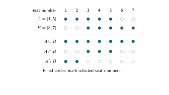
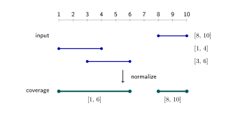
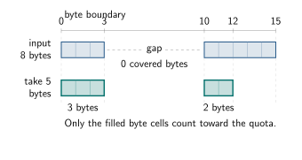
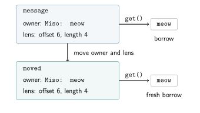
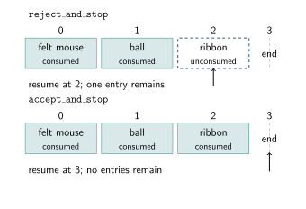

# Datum tutorials

All sections and their examples are provisional while Datum continues to evolve.

Datum provides operations for observing and selecting data, from fragmented bytes
to fields of ordinary records. We will explore them through small programs, using
standard-library storage and algorithms alongside Datum. Familiarity with C++ ranges,
lambdas, and references will help. Each lesson links to a complete program and one
small variation; the [build appendix](#appendix-a-building-and-running) explains how
to configure them and check their output. Use the Datum source accompanying this guide.

The core lessons use C++23, including generated record views, record-field selection,
and the optional codec lesson. For **Domain Vocabulary: Ceph**,
follow chapter 1 with [chapter 18](#18-bytes-with-a-ceph-accent), which applies the same
byte vocabulary to native buffers. Chapters 16–17 preview separate RGW bindings and require additional
sources described in the appendix.

The [index](docs/lookup.md) offers a task finder and short definitions, and the
[bibliography](#bibliography) includes optional background reading.
Select a figure to open it at full size.

## 1 hello, world! — in pieces

*Read bytes across separate fragments without joining them into one buffer.*

Data often comes in separate buffers. A Datum byte cursor lets us observe a
bounded sequence across those buffers without first gathering them into a string.

The [complete program](examples/01_hello_fragments.cpp) includes `<datum/bytes.h>`
and uses `datum` as a short alias for `ceph::salad::datum`. Our greeting occupies
four fragments:

```cpp
using namespace std::string_view_literals;

const std::array fragments {"hell"sv, "o, w"sv, "orld"sv, "!\n"sv};
```

Construct a cursor over that fragment range and take the fourteen bytes, including
the final newline:

```cpp
// Read all 14 bytes across the fragment boundaries:
datum::byte_cursor input {fragments};
const auto greeting = input.take(14);
```

`take(14)` advances the cursor and returns a slice whose spans refer to the original
bytes. Each span covers one contiguous piece; the slice can contain several spans
when it crosses fragment boundaries. It borrows the fragment range and its bytes.
A request larger than the remaining input throws `std::length_error` before advancing
the cursor.

Pass those spans to a printing callback:

```cpp
// Send each borrowed span to the output sink:
datum::write_fragments(greeting, [](const auto block) {
    std::print("{}", std::string_view {block});
});
```

`write_fragments` calls the callback synchronously for each span, in source order,
and returns `void`. The temporary `std::string_view` observes that span's characters;
no staging string is needed.
Keep both the fragment range and its backing bytes valid while using the slice.
Here, the array remains in scope, and the bytes belong to string literals.

The output is:

```text
hello, world!
```

### A small variation

Move the fragment boundaries, as in the
[complete variation](examples/01_hello_fragments_variation.cpp):

```cpp
const std::array fragments {"hello, w"sv, "orld!\n"sv};
```

Copy them into an ordinary array when a contiguous destination is useful:

```cpp
std::array<char, 14> greeting {};
datum::copy(fragments, greeting);
std::print("{}", std::string_view {greeting});
```

`copy(source, output)` copies the complete source after checking that the output has
room. It returns a span over the bytes written; a larger output keeps its remaining
bytes unchanged. Source and output must not overlap. Contiguous byte sources use the
same interface. For a selection, add a `byte_extent {offset, length}` argument; an
offset alone uses the output size as the count. Invalid bounds throw before writing.

When a consumer expects fragments, `datum::fragments(owner)` adapts a contiguous
owner to a one-fragment view. Its span borrows the bytes, so keep the backing storage alive.

For a destination that grows, include `<datum/range.h>` and append a joined view:

```cpp
std::string contiguous;
datum::append_range(contiguous, fragments | std::views::join);
```

`views::join` exposes the characters across the fragments without allocating.
`append_range` appends those characters to the destination string; this step copies
into owned contiguous storage. The complete variation checks that the two destinations
contain the same greeting. The operation also accepts a single-pass input range and
works with other growable standard sequences, such as `std::vector` and `std::list`.
It uses a native C++23 `append_range` member when available and a portable fallback
on the GCC 14 library. Prefer views and range operations for this sort of selection,
transformation, and insertion.

### Prefer the supplied byte vocabulary

`datum::byte_extent {offset, length}` describes a byte range without owning any
storage. Use it when passing a selection between operations; a routine copy needs
no application-specific byte type. The later byte lessons use this supplied
vocabulary, and [chapter 18](#18-bytes-with-a-ceph-accent) applies it to native Ceph
buffers through `<ceph-datum.h>`.

### Did you know?

Brian Kernighan used the greeting in a B tutorial published in a January 1973
Bell Labs report. Dennis Ritchie later recalled it as the earliest Hello, World
example that he and Kernighan remembered.
([1](https://www.nokia.com/bell-labs/about/dennis-m-ritchie/btut.html),
[2](https://cm-bell-labs.github.io/who/dmr/bintro.html))

That B example already printed the greeting in pieces: `hell`, `o, w`, and `orld`,
followed by an exclamation mark and a newline together in the last chunk. Our
fragments follow that same division, including the final newline.
([1](https://www.nokia.com/bell-labs/about/dennis-m-ritchie/btut.html))

Kernighan and Ritchie went on to publish *The C Programming Language* in 1978.
([3](https://cm-bell-labs.github.io/who/dmr/chist.html))

## 2 Seat 3 is reserved

*Select an interval of values and exclude a value with interval difference.*

A row has ten seats. We want seats 1–5, except that seat 3 is reserved. Describe
that selection with Datum, then apply it to the row with a standard range filter.

The [complete program](examples/02_seat_selection.cpp) includes
`<datum/interval/query.h>` and uses `iv` as a short alias for `datum::interval`.
An ordered domain tells Datum what its points are and how to compare them.
Datum's `comparison_domain<int>` supplies integer points and their standard
ordering; the named derived type identifies them as seat numbers:

```cpp
// Define the ordered integer domain used by the selection:
struct seat_numbers final : iv::comparison_domain<int> {};
```

Create the row and describe the available seats:

```cpp
const auto seats = std::views::iota(1, 11);

// Select seats 1–5, then exclude the reserved seat:
const auto selection = iv::without(iv::closed_between<seat_numbers>(1, 5), 3);
```

`closed_between` includes both endpoints: seats 1 and 5 are eligible.
`without` expresses set difference by excluding seat 3.
([5](https://github.com/chardan/ceph/blob/jfw-datum/src/rgw/datum/include/datum/interval/query.h))

Test each seat against the selection with `contains(selection, seat)`:

```cpp
// Apply the selection with a standard range filter:
auto available_seats = seats | std::views::filter([&selection](const int seat) {
    return iv::contains(selection, seat);
});
```

The input view supplies seats 1 through 10: `iota` excludes its upper bound, 11.
The selection describes membership; the filter visits the input and keeps matching
values. The complete program prints those values separated by commas:

```text
1, 2, 4, 5
```

The same selection can be reused by another consumer that asks whether a seat
belongs. Changing the availability rule leaves the filtering code alone.

### A small variation

Reserve seat 5 instead, as in the
[complete variation](examples/02_seat_selection_variation.cpp):

```cpp
// Select seats 1–5, then exclude the reserved seat:
const auto selection = iv::without(iv::closed_between<seat_numbers>(1, 5), 5);
```

Seat 3 becomes available, and seat 5 is removed:

```text
1, 2, 3, 4
```

## 2½: An Interval Interlude

*Combine seat selections with union, intersection, and difference.*

Return to the numbered seats. An interval describes which points belong between
its boundaries. Square brackets include an endpoint; parentheses exclude it:

| Notation | Meaning for seat numbers |
| --- | --- |
| `[1, 5]` | Include seats 1 through 5. |
| `[1, 5)` | Include seats 1 through 4. |
| `(1, 5)` | Include seats 2 through 4. |
| `[3, 3]` | Select just seat 3: a singleton. |
| `[3, 3)` | Select no seats: an empty interval. |

An interval can also have an unbounded end. The domain supplies ordering, while
the input range supplies the points we actually visit.

The [complete program](examples/02_half_interval_interlude.cpp) uses the same
`seat_numbers` domain as section 2. Make two closed selections:

```cpp
const auto seats = std::views::iota(1, 11);
const auto a = iv::closed_between<seat_numbers>(1, 5);
const auto b = iv::closed_between<seat_numbers>(3, 7);
```

For these selections:

- `set_union(a, b)` includes points in either selection.
- `intersection(a, b)` includes points in both selections.
- `difference(a, b)` includes points in `a` that are absent from `b`; argument order matters.

[](figures/02_half_interval_interlude.svg)

The result rows show union, intersection, and difference. Each filled circle
marks a selected seat number.

For background on half-open integer ranges, see
[Dijkstra's short note on indexing](https://www.cs.utexas.edu/~EWD/transcriptions/EWD08xx/EWD831.html).

Combine the selections directly:

```cpp
// Describe the three combinations:
const auto together = iv::set_union(a, b);
const auto overlap = iv::intersection(a, b);
const auto only_a = iv::difference(a, b);
```

Each result supports the same `contains(selection, seat)` test as section 2.
The complete program filters the numbered row against each selection and prints
the matching seats. The combinations are lazy expressions: `contains` evaluates membership when asked.
These simple interval operands are copied into the expressions, retaining their boundary values.
([5](https://github.com/chardan/ceph/blob/jfw-datum/src/rgw/datum/include/datum/interval/query.h))

The output is:

```text
A: [1, 2, 3, 4, 5]
B: [3, 4, 5, 6, 7]
A union B: [1, 2, 3, 4, 5, 6, 7]
A intersection B: [3, 4, 5]
A minus B: [1, 2]
```

### A small variation

Move `b` away from `a`, as in the
[complete variation](examples/02_half_interval_interlude_variation.cpp):

```cpp
const auto b = iv::closed_between<seat_numbers>(7, 9);
```

The intersection is empty, and the union preserves the gap at seat 6:

```text
A: [1, 2, 3, 4, 5]
B: [7, 8, 9]
A union B: [1, 2, 3, 4, 5, 7, 8, 9]
A intersection B: []
A minus B: [1, 2, 3, 4, 5]
```

A selection can cover several separate pieces, as the `without` example already
showed. These operations determine membership; the next lesson prepares ordered,
merged interval coverage for reuse. Ordering alone supplies neither a distance
nor a next value. Section 6 adds a metric when we need to count covered bytes.

## 3 Untangle the ranges

*Merge overlapping intervals and report their coverage in order.*

Three intervals arrive out of order, and two overlap. We want their coverage in
order, with the overlap merged and the gap preserved.

The [complete program](examples/03_normalize_ranges.cpp) uses an integer domain
named `positions`, declared like the seat-number domain in section 2.
Start with three closed intervals:

```cpp
struct positions final : iv::comparison_domain<int> {};

const std::array ranges {
    iv::closed_between<positions>(8, 10),
    iv::closed_between<positions>(1, 4),
    iv::closed_between<positions>(3, 6)
};
```

Normalize them with `compile_intervals`:

```cpp
// Merge overlaps and put the covered intervals in order:
const auto coverage = iv::compile_intervals(ranges);
```

The returned `canonical_range` owns an ordered collection of intervals, merging overlaps
while preserving the points covered by the input. Here, `[1, 4]` and `[3, 6]` become `[1, 6]`,
followed by the separate interval `[8, 10]`.
([5](https://github.com/chardan/ceph/blob/jfw-datum/src/rgw/datum/include/datum/interval/query.h))

[](figures/03_normalize_ranges.svg)

The [design discussion of canonical operands and evaluation](https://github.com/chardan/ceph/blob/jfw-datum/src/rgw/datum/README.md#canonical-operands-and-evaluation)
explains how prepared coverage can be reused.

The filled dots mark included endpoints. Print the normalized intervals:

```cpp
for (const auto& interval : coverage) {
    std::println("[{}, {}]", interval.lower().key(), interval.upper().key());
}
```

The output is:

```text
[1, 6]
[8, 10]
```

`lower()` and `upper()` expose each interval's boundaries; `key()` gives the
position of a finite boundary. All the boundaries here are finite and included,
so square brackets describe them accurately. The normalized set can now be reused
for membership tests and further set operations.

### A small variation

Add an interval that bridges the gap, as in the
[complete variation](examples/03_normalize_ranges_variation.cpp):

```cpp
iv::interval_batch<positions, 4> pending {ranges};
pending.append_range(std::views::single(iv::closed_between<positions>(6, 8)));
const auto coverage = iv::compile_intervals(pending);
```

`interval_batch` stores up to four intervals inline. Its `append_range` accepts
ordinary ranges and views; here `views::single` supplies one bridging interval.
Appending preserves the entries as supplied, and `compile_intervals`
normalizes them into a separate owned result. The bridge meets the two pieces at their
included endpoints, so the normalized coverage becomes a single interval:

```text
[1, 10]
```

## 4 Put 2 before 10

*Encode integer keys so byte order matches numeric order.*

A store orders keys by their encoded bytes. We want item 2 before item 10, but
ordinary decimal text puts `"10"` before `"2"`. Choose the numeric segment's
encoding explicitly so that key order follows numeric order.

The [complete program](examples/04_numeric_keys.cpp) includes `<datum/key.h>` for
encoding and `<datum/compare.h>` for the sorting projection. It uses `key` as a
short alias for `datum::key`. Keep each number alongside its key so we can print
the order after sorting:

```cpp
using keyed_number = std::pair<key::encoded_key, std::uint16_t>;

const std::array<std::uint16_t, 3> numbers {10, 2, 1};
```

Build one collection with decimal segments and another with fixed-width hexadecimal
segments. Both give every key the same first segment, `"item"`:

```cpp
// Decimal segments sort as text:
auto decimal_keys = numbers | std::views::transform([](const auto number) {
    return keyed_number {key::compose("item", key::decimal_segment(number)), number};
}) | std::ranges::to<std::vector>();

// Equal-width hexadecimal segments preserve unsigned numeric order:
auto numeric_keys = numbers | std::views::transform([](const auto number) {
    return keyed_number {key::compose("item", key::fixed_width_hexadecimal_segment(number)), number};
}) | std::ranges::to<std::vector>();
```

`compose` builds an owned key from its segments. The fixed-width encoder writes
hexadecimal digits with the most significant digit first. Its width comes from
the unsigned integer type: our `std::uint16_t` values produce four characters.
Use that same type consistently for numbers in the segment.
([6](https://github.com/chardan/ceph/blob/jfw-datum/src/rgw/datum/include/datum/key.h))

| Number | Decimal segment | Fixed-width hexadecimal segment |
| --- | --- | --- |
| 1 | `"1"` | `"0001"` |
| 2 | `"2"` | `"0002"` |
| 10 | `"10"` | `"000A"` |

`encoded_key` compares its encoded bytes. Sort the pairs by those keys:

```cpp
// Sort by encoded bytes, keeping each number attached to its key:
std::ranges::sort(decimal_keys, {}, datum::nth_key<0>);
std::ranges::sort(numeric_keys, {}, datum::nth_key<0>);
```

`datum::nth_key<0>` projects the first tuple or pair element. The `{}` selects
the standard algorithm's default comparison, which compares those projected keys;
sorting moves each whole pair, keeping its number attached. The complete program
prints the second elements, the numbers, in their resulting order:

```text
decimal: 1, 10, 2
fixed-width hex: 1, 2, 10
```

For several fields with different directions, `datum::order_by` combines
`datum::ascending` and `datum::descending` projections into a sorting predicate.
It consults later fields only when the earlier fields compare equivalent.
A single key, as here, needs only the standard algorithm's projection argument.

### A small variation

Try numbers around a hexadecimal digit boundary, as in the
[complete variation](examples/04_numeric_keys_variation.cpp):

```cpp
const std::array<std::uint16_t, 3> numbers {16, 2, 15};
```

The variation also shows a path whose segments arrive as a range:

```cpp
const std::array path {"bucket"sv, "cats"sv, "Miso"sv};
const auto object = key::compose_range(path);
```

`compose_range` accepts a range of string-like segments, including an input view
whose length is known only at runtime. It produces the same owned encoding as
`compose("bucket", "cats", "Miso")`. An empty range or empty first segment is
invalid; empty later segments and embedded NUL bytes retain their ordinary key
encoding. Generated temporary strings are consumed during each visit rather than
stored as borrowed views. Use `compose` for fixed arguments or tuples and
`compose_range` for a sequence supplied as a range.

The segments for 15 and 16 are `"000F"` and `"0010"`. Their order is preserved
across the change in digits:

```text
decimal: 15, 16, 2
fixed-width hex: 2, 15, 16
```

## 5 Keep the label on the slice

*Clip records to selected intervals and identify the source of each resulting cut.*

Two cats, Miso and Mochi, have supplied a conversation with naps at either end.
Select bytes `[4, 12)` to trim the naps, keeping each piece attached to its speaker's
name. Datum's `clip_view` keeps that source association as it clips the records.

The [complete program](examples/05_labeled_slices.cpp) includes
`<datum/interval/clip.h>`. The built-in `iv::byte_query` supplies unsigned byte
positions and their ordering; `interval` is a short alias for that type.
Each ordinary record carries a name, its starting byte position, and its text:

```cpp
struct text_record final
{
    std::string_view name;
    std::uint64_t offset;
    std::string_view text;
};
```

Create the records and prepare the selection with `compile_intervals`:

```cpp
using interval = iv::byte_query;

const std::array records {
    text_record {"Miso", 0, "zzz meow"},
    text_record {"Mochi", 8, "purr zzz"}
};
const auto selection = iv::compile_intervals(interval::closed_open(4, 12));
```

These intervals are half-open: the lower endpoint is included, and the upper
endpoint is excluded. The records meet at position 8 without overlapping:

| Record | Extent | Selected part |
| --- | --- | --- |
| `Miso` | `[0, 8)` | `[4, 8)` |
| `Mochi` | `[8, 16)` | `[8, 12)` |

`clip_view` takes the source records, the canonical selection, and a geometry lens.
The lens reads one record and returns a plain `byte_extent {offset, length}`.
Datum converts that geometry into checked half-open bounds:

```cpp
// Keep the source record attached to each clipped interval:
const iv::clip_view cuts {records, selection, [](const text_record& row) {
    return datum::byte_extent {row.offset, row.text.size()};
}};
```

`clip_view` checks that the records' extents are ordered and disjoint. It produces
separate cuts at record boundaries. Each cut exposes its original record through
`source()` and its selected bounds through `lower()` and `upper()`.
([7](https://github.com/chardan/ceph/blob/jfw-datum/src/rgw/datum/include/datum/interval/clip.h))

Use the cut's global bounds to observe the matching text within its source record:

```cpp
for (const auto& cut : cuts) {
    const auto& record = cut.source();
    const auto lower = cut.lower().key();
    const auto upper = cut.upper().key();

    // Convert global cut bounds to a substring within that source record:
    std::println("{} [{}, {}): \"{}\"", record.name, lower, upper,
                 record.text.substr(lower - record.offset, upper - lower));
}
```

`lower - record.offset` is the starting position within that record's text;
`upper - lower` is the selected byte count. `substr` returns another
`std::string_view`, observing the original characters.

Read each cut's bounds before the iterator advances: they borrow from the iterator
and the selection. Keep the records, selection, and backing text valid, and leave
the records and selection unchanged during traversal. The loop consumes each cut
within those lifetimes.

The output keeps both speakers' names:

```text
Miso [4, 8): "meow"
Mochi [8, 12): "purr"
```

### A small variation

Start the selection exactly at the record boundary, as in the
[complete variation](examples/05_labeled_slices_variation.cpp):

```cpp
const auto selection = iv::compile_intervals(interval::closed_open(8, 12));
```

Miso's record ends at its excluded endpoint, 8, so it contributes no cut:

```text
Mochi [8, 12): "purr"
```

## 6 Five bytes, please

*Use a metric to take up to a quota of covered bytes without counting gaps.*

A byte is "covered" when its position lies inside one of our input intervals.
Here, `[0, 3)` covers byte positions 0, 1, and 2, and `[10, 15)` covers positions 10–14.
The seven positions 3–9 lie in the gap and contribute nothing to the quota.

Take the first five of the eight covered bytes. The gap does not count toward the five-byte quota.

The [complete program](examples/06_covered_quota.cpp) includes
`<datum/interval/metric.h>`. As in the previous lesson, `interval` names
`iv::byte_query`. Prepare the half-open coverage:

```cpp
// A covered byte has a position inside one of these intervals; gaps consume no quota.
const std::array ranges {
    interval::closed_open(0, 3),
    interval::closed_open(10, 15)
};
const auto coverage = iv::compile_intervals(ranges);
```

An ordered domain tells Datum how to compare positions. A metric adds the distance
and arithmetic needed to count bytes and advance a position. Here, byte positions
and byte counts both use `std::uint64_t`. Datum supplies `iv::bytes`, a metric with
checked arithmetic for this byte geometry. Pass `take` the canonical coverage, the
byte quota, and the supplied metric:

```cpp
const std::uint64_t quota = 5;

// Count only covered bytes toward the quota:
const auto selected = iv::take(coverage, quota, iv::bytes);
```

`take` walks the coverage in order, counting only covered distances and trimming
the final interval when the remaining quota runs out. The result owns its selected
intervals. It describes byte positions, without reading or retaining payload bytes;
use those positions with clipping or copying when you need the data itself.
These metric operations require finite half-open canonical coverage.
([8](https://github.com/chardan/ceph/blob/jfw-datum/src/rgw/datum/include/datum/interval/metric.h))

[](figures/06_covered_quota.svg)

The selected pieces supply three bytes and two bytes. The gap contributes none.

Use `measure` with the same metric to total the available and selected coverage,
then print each selected interval:

```cpp
std::println("on the menu: {} bytes", iv::measure(coverage, iv::bytes));
std::println("order: {} bytes", quota);

for (const auto& span : selected) {
    std::println("[{}, {})", span.lower().key(), span.upper().key());
}

std::println("served: {} bytes", iv::measure(selected, iv::bytes));
```

The first interval supplies three bytes. The remaining two come from positions
10 and 11, so the selected second interval ends at its excluded endpoint, 12:

```text
on the menu: 8 bytes
order: 5 bytes
[0, 3)
[10, 12)
served: 5 bytes
```

### A small variation

Ask for ten bytes, as in the
[complete variation](examples/06_covered_quota_variation.cpp):

```cpp
const std::uint64_t quota = 10;
```

`take` returns all eight available bytes. The quota is an upper limit;
the kitchen has eight:

```text
on the menu: 8 bytes
order: 10 bytes
[0, 3)
[10, 15)
served: 8 bytes
```

## 7 Move it and keep reading

*Keep a string and slice descriptor together so the slice can be recomputed after a move.*

Moving an owner can change where its bytes live. A saved `std::string_view` does
not track that change. Datum's `retained_view` keeps an owner together with a
lens: a description of how to observe part of that owner. Here, the retained object
keeps the string alive; the spans obtained from it still borrow the string's bytes.

The [complete program](examples/07_retained_slice.cpp) includes `<datum/bytes.h>`
and `<datum/ownership.h>`. Keep Miso's message and select its four-byte reply:

```cpp
// Store the owner together with an offset-and-length lens:
datum::retained_view message {std::string {"Miso: meow"}, datum::byte_slice {6, 4}};
std::println("before move: {}", std::string_view {message.get()});
```

The string owns the characters and is moved into `message`. `byte_slice {6, 4}`
stores an offset and a length, like `byte_extent`, and also acts as a callable
lens on byte storage. Calling `get()` applies that lens to the retained string,
checks the slice bounds, and returns a borrowed span. The `string_view`
adapts that character span for printing without copying the text.
([9](https://github.com/chardan/ceph/blob/jfw-datum/src/rgw/datum/include/datum/ownership.h),
[10](https://github.com/chardan/ceph/blob/jfw-datum/src/rgw/datum/include/datum/bytes.h))

Move the retained value, then read from its destination:

```cpp
// Move the retained value, then recompute its slice:
const auto moved = std::move(message);
std::println("after move: {}", std::string_view {moved.get()});
```

`retained_view` moves its owner and lens together. It does not cache a span into
the original string: `moved.get()` computes the projection from the destination's
string. Both observations therefore select the same four characters:

```text
before move: meow
after move: meow
```

[](figures/07_retained_slice.svg)

The returned span still borrows from its owner. Use it while that owner remains
alive and unmoved; after a move, request a fresh projection from the destination.
See the [design discussion of geometry and data views](https://github.com/chardan/ceph/blob/jfw-datum/src/rgw/datum/README.md#geometry-and-data-views)
for the ownership contract. The
[original `span` proposal](https://www.open-std.org/jtc1/sc22/wg21/docs/papers/2018/p0122r7.pdf)
provides historical background on views over separately owned storage.

### A small variation

Change only the slice offset from six to zero, as in the
[complete variation](examples/07_retained_slice_variation.cpp):

```cpp
// Store the owner together with an offset-and-length lens:
datum::retained_view message {std::string {"Miso: meow"}, datum::byte_slice {0, 4}};
```

The same move now preserves the selection of the speaker's name:

```text
before move: Miso
after move: Miso
```

## 8 A window into Miso's toy basket

*Read a record's current field values through a borrowed view.*

A record view can expose named fields without copying their values. Miso's basket
starts with seven toys. Add one toy and read the updated count through the same view.
The [complete program](examples/08_toy_basket.cpp) includes `<datum/record.h>`
and declares the record with `DATUM_RECORD`:

```cpp
#define BASKET_FIELDS(Field) \
    Field(std::string, label) \
    Field(int, toys)
DATUM_RECORD(basket_record, BASKET_FIELDS);
#undef BASKET_FIELDS
```

Each `Field` supplies a type and member name. `DATUM_RECORD` declares an ordinary
aggregate and the complete member information needed to generate named views in
C++23. The field list is written once; the temporary `BASKET_FIELDS` macro can then
be undefined. Aggregate initialization and direct member access work as usual.

Create the basket record and a view of it:

```cpp
// Build a borrowed view of the chosen source record:
basket_record basket {"Miso's basket", 7};
const datum::view_of inventory {basket};
```

`view_of` uses that declaration to give `inventory` fields named `label` and `toys`.
The default field projections are const references to the original members:
`inventory.label` observes `basket.label`, and `inventory.toys` observes `basket.toys`.
Constructing the view copies neither the string nor the integer.
With C++26 reflection, the same view can also be generated from an ordinary struct
declaration. The optional backend build in the appendix checks this example with
reflection enabled; the default C++23 build needs no reflection support.
([11](https://github.com/chardan/ceph/blob/jfw-datum/src/rgw/datum/include/datum/record.h))

Print through the view, add a toy to the count, and print through the view again:

```cpp
std::println("before: {} holds {} toys", inventory.label, inventory.toys);

// Change the original basket, then observe the view again:
++basket.toys;
std::println("after: {} holds {} toys", inventory.label, inventory.toys);
```

The references provide read-only access, but the source record can still change.
Declaring `inventory` const does not prevent updating `basket` or capture its initial values:

```text
before: Miso's basket holds 7 toys
after: Miso's basket holds 8 toys
```

The view does not own the basket record. The basket record must outlive the view.
`view_of` accepts an lvalue source and rejects a temporary record. If you move the
basket into another object, this view still refers to the original, possibly
moved-from basket; construct a new view to observe the destination.

### A small variation

Make a copy first, then view that copy, as in the
[complete variation](examples/08_toy_basket_variation.cpp):

```cpp
const auto snapshot = basket;
const datum::view_of inventory {snapshot};
```

The later increment still updates `basket`, while `inventory` now observes
`snapshot`. Its copied label and toy count retain their earlier values:

```text
before: Miso's basket holds 7 toys
after: Miso's basket holds 7 toys
```

## 9 Pick the basket fields

*Choose record fields and their reading order with a field profile.*

Print the toy count first, then the basket label. A field profile is an ordered
list of members to read. Here, the profile contains `toys` and `label`, leaving out
`capacity`.

The [complete program](examples/09_selected_fields.cpp) includes `<datum/record.h>`
and adds capacity to the familiar basket record:

```cpp
struct basket_record final
{
    std::string label;
    int toys;
    int capacity;
};
```

Name the selected fields and their order:

```cpp
// Select fields in the order the consumer will read them:
using basket_fields = datum::member_fields<&basket_record::toys, &basket_record::label>;
```

The member pointers identify fields of the original record. Their order in the
profile controls observation order, independently of declaration order. Here,
`toys` comes before `label`, and `capacity` is omitted.
([11](https://github.com/chardan/ceph/blob/jfw-datum/src/rgw/datum/include/datum/record.h))

Give the profile to `print_fields`, a generic function defined by this example:

```cpp
template <typename FieldsT>
void print_fields(const auto& record)
{
    // Read each selected field directly from the supplied record:
    FieldsT::observe(record, [](const auto& value) { std::println("{}", value); });
}
```

`observe(record, consumer)` calls the consumer for each selected value of the record,
in profile order. Our void-returning lambda accepts each value by const reference:
first an integer, then a string. The printing function names no basket members.

Use the profile directly with the ordinary basket record:

```cpp
const basket_record basket {"Miso's basket", 7, 12};
print_fields<basket_fields>(basket);
```

The explicit template argument chooses the profile; the function deduces the
source type. Member pointers read the original record directly: this C++23 operation
needs neither a generated view nor complete-record metadata. When a generated view
of that same record is available, the profile can observe it too.
Each selected value is printed on its own line:

```text
7
Miso's basket
```

Section 8 shows the named-view form; the
[design guide](https://github.com/chardan/ceph/blob/jfw-datum/src/rgw/datum/README.md#observation-and-wire-schemas)
explains how observation differs from ownership and wire enrollment.

### A small variation

Reverse only the profile order, as in the
[complete variation](examples/09_selected_fields_variation.cpp):

```cpp
// Select fields in the order the consumer will read them:
using basket_fields = datum::member_fields<&basket_record::label, &basket_record::toys>;
```

The record and printing function stay the same. The output follows the
new order, still omitting capacity:

```text
Miso's basket
7
```

## 10 Keep your place

*Save an owned resume position when a scan stops before or after consuming an entry.*

Process an inventory list in two passes. The first pass accepts the felt mouse
and ball entries, then stops before consuming the ribbon entry. The second pass
starts with the ribbon.

The [complete program](examples/10_scan_resume.cpp) includes
`<datum/traversal/scan.h>`. Each `toy` entry has an index and a name:

```cpp
struct toy final
{
    std::size_t index;
    std::string_view name;
};

const std::array toys {
    toy {0, "felt mouse"},
    toy {1, "ball"},
    toy {2, "ribbon"}
};
```

Each index is a position in the array. Datum provides `scan_range`, which calls
an adapter supplied by the caller to save a position and choose where to resume.
Here, `toy_positions` implements that contract for our array indices. Saving a
position value lets the result survive the scan's iterator. The caller chooses
what that value means and how to use it later; the required operations are named
`position` and `next`:

```cpp
// Datum's position() and next() operations, implemented here for array indices:
struct toy_positions final
{
    std::size_t position(const toy& entry) const { return entry.index; }

    std::size_t next(const std::size_t index, const bool consumed) const
    {
        return consumed ? 1 + index : index;
    }

};
```

Datum calls `toy_positions::position` before the callback; this implementation
copies `entry.index`. If the callback stops, Datum calls `toy_positions::next`
with that saved index and whether the entry was consumed. Our adapter keeps the
index for a rejected entry or returns the following index for a consumed entry.

Datum returns a `scan_result` whose optional `resume` member holds the position
computed by `next`. In this example, `scan.resume` holds the array index by value; it does not retain
the array or a copy of its entries.
([13](https://github.com/chardan/ceph/blob/jfw-datum/src/rgw/datum/include/datum/traversal/scan.h))

Pass `scan_range` the toy range, an acceptance callback, and `toy_positions`.
The callback prints each offered entry, accepts the first two, and rejects the ribbon:

```cpp
const auto stop = datum::acceptance::reject_and_stop;

// Count offers and consumption, retaining an owned resume index:
const auto scan = datum::traversal::scan_range(toys, [stop](const toy& entry) {
    std::println("offered: {}", entry.name);
    return 2 == entry.index ? stop : datum::acceptance::accept;
}, toy_positions {});
```

An entry is offered when the callback receives it. Returning `accept` counts it
as consumed. Returning `reject_and_stop` stops with the current entry unconsumed,
even though the callback has seen it. The scan returns without advancing the
iterator again.
([12](https://github.com/chardan/ceph/blob/jfw-datum/src/rgw/datum/include/datum/traversal.h))

Report progress, then use the saved index to select the remaining entries.
`std::span::subspan` is a standard-library operation; the loop below is the
example's second pass. Datum returns the position, and the caller uses it:

```cpp
std::println("offered: {}, consumed: {}", scan.progress.offered, scan.progress.consumed());

if (scan.resume) {

    // Apply the saved index to the original array:
    const auto remaining = std::span {toys}.subspan(*scan.resume);
    std::println("resume index: {}", *scan.resume);
    std::println("remaining: {}", std::size(remaining));

    for (const auto& entry : remaining) {
        std::println("resumed: {}", entry.name);
    }
}
```

Three entries were offered, but only two were consumed. Index 2 selects the ribbon
entry again. The array stays unchanged, so its indices still identify the same entries:

```text
offered: felt mouse
offered: ball
offered: ribbon
offered: 3, consumed: 2
resume index: 2
remaining: 1
resumed: ribbon
```

`scan.progress` is a `visit_result`. Its `offered` and `accepted` members count offers
and accepted entries; `consumed()` derives the consumed count. `stopped()` reports an
early stop, and the optional `stop` member preserves its acceptance decision. Here it
contains `reject_and_stop`; a scan that reaches the end has no stopping decision.

### A small variation

Accept the ribbon entry before stopping, as in the
[complete variation](examples/10_scan_resume_variation.cpp). Change only the
stopping decision:

```cpp
const auto stop = datum::acceptance::accept_and_stop;
```

Now all three entries are consumed. The saved index is 3, the end of the array,
so the remaining range is empty:

```text
offered: felt mouse
offered: ball
offered: ribbon
offered: 3, consumed: 3
resume index: 3
remaining: 0
```

[](figures/10_scan_resume.svg)

The saved index identifies the next entry to consume. The stopping decision
determines whether that is the offered ribbon or the end of the array.

## 11 The discreet log

*Choose which record fields to show, redact, or omit in diagnostic output.*

Print a login record for diagnostics: include Juniper's public name, replace the
password with a redaction marker, and leave out an internal note.

The [complete program](examples/11_discreet_log.cpp) includes
`<datum/render/std_format.h>`. Its source record is an ordinary struct:

```cpp
struct login_record final
{
    std::string name;
    std::string password;
    std::string internal_note;
};
```

In `ceph::salad::datum::render`, specialize `display_schema` to choose its
diagnostic fields:

```cpp
namespace ceph::salad::datum::render {

template <>
struct display_schema<login_record> final
{
    static constexpr std::string_view name = "login_record";

    // Approve exactly these diagnostic fields:
    static constexpr auto fields = std::tuple {
        field<&login_record::name>("name"),
        display_field<&login_record::password, display_field_policy::redacted> {"password"}
    };
};

} // ceph::salad::datum::render
```

`field` selects the name's value. The password's descriptor instead selects
redaction: its contents are hidden, but its byte count is shown. `internal_note`
has no descriptor and is omitted. The string arguments supply the displayed field
labels; tuple order supplies their display order. The schema also supplies the
record label explicitly, so this example works in both C++23 and C++26.
([14](https://github.com/chardan/ceph/blob/jfw-datum/src/rgw/datum/include/datum/render/display.h))

This diagnostic selection is independent of the `member_fields` profile from
section 9. Adding a member to the record does not add it to this explicit tuple.

The specialization chooses the example's policy; Datum supplies the descriptors
and `<datum/render/std_format.h>` opts into its standard formatter. Print the record
with `std::println`:

```cpp
const login_record login {"Juniper", "sesame", "local only"};

// Format the record using its approved diagnostic fields:
std::println("{}", login);
```

The six-byte password contributes only its redaction marker and size:

```text
login_record{name="Juniper", password=<redacted:6 bytes>}
```

### A small variation

Omit the password entirely, as in the
[complete variation](examples/11_discreet_log_variation.cpp). Change only the
schema's field selection:

```cpp
// Approve exactly these diagnostic fields:
static constexpr auto fields = std::tuple {field<&login_record::name>("name")};
```

Now the password's label and byte count are absent too:

```text
login_record{name="Juniper"}
```

## 12 Send a postcard

*Encode and decode a postcard's recipient and message, excluding its local tracking number.*

Encode a postcard for Juniper. Include its recipient and message, leaving out
the sender's local tracking number.

The [complete program](examples/12_postcard.cpp) uses C++23 and the optional zpp codec
adapter; see the [setup](#enable-the-codec-lesson). Include `<datum/codec/zpp.h>` and
`<datum/record_definition.h>`.

Checked wire schemas need facts about the record's complete declaration. In C++23,
`DATUM_RECORD` supplies those facts from the same field-list form used in section 8:

```cpp
#define POSTCARD_FIELDS(Field) \
    Field(std::string, recipient) \
    Field(std::string, message) \
    Field(int, local_id, 0)
DATUM_RECORD(postcard, POSTCARD_FIELDS);
#undef POSTCARD_FIELDS
```

Each `Field` entry supplies a type, member name, and optional default initializer.
The local tracking number defaults to zero. Undefining the temporary field-list macro
keeps it out of subsequent declarations. Ordinary aggregate initialization still works.
C++26 reflection can obtain the same facts from an ordinary struct declaration; it is
not required for this codec lesson. Selected-field observation in section 9 does not
need complete record facts because it reads only the explicit member pointers.

Use `binary_fields` to select the two fields in their encoding order:

```cpp
// Select the transmitted fields and their wire order:
using postcard_wire = datum::binary_fields<&postcard::recipient, &postcard::message>;
```

`postcard_wire` is a Datum schema descriptor. The member pointers select `recipient`
followed by `message`, omitting `local_id`. Datum infers `postcard` from the first
member pointer; this nonempty selection needs no separate record type argument.
The encoder and decoder use the same schema. This wire selection is independent
of section 11's diagnostic policy: redacting a field in logs does not exclude it
from encoding.
([11](https://github.com/chardan/ceph/blob/jfw-datum/src/rgw/datum/include/datum/record.h))
The [design discussion of observation and wire schemas](https://github.com/chardan/ceph/blob/jfw-datum/src/rgw/datum/README.md#observation-and-wire-schemas)
explains their separate contracts.

Create a postcard, encode it, and decode the resulting bytes:

```cpp
const postcard sent {"Juniper", "wish you were here", 7};

// Round-trip the selected fields; local_id is outside this schema:
const auto bytes = datum::to_bytes<postcard_wire>(sent);
const auto received = datum::from_bytes<postcard_wire>(bytes);
```

These codec functions live directly in `datum`; they encode and decode in memory,
without sending a message. `to_bytes` returns an owning byte buffer. The one-argument
`from_bytes` call constructs and returns a fresh `postcard`: it value-initializes the record, then
decodes the selected fields. The omitted `local_id` keeps its default of zero.
([15](https://github.com/chardan/ceph/blob/jfw-datum/src/rgw/datum/include/datum/codec/zpp.h))

Print the decoded text and compare the sender's local ID with the decoded local ID:

```cpp
std::println("to: {}", received.recipient);
std::println("message: {}", received.message);
std::println("local id: {} -> {}", sent.local_id, received.local_id);
```

The message survives the round trip; the sender's tracking number was not encoded:

```text
to: Juniper
message: wish you were here
local id: 7 -> 0
```

### A small variation

Decode into an existing record, as in the
[complete variation](examples/12_postcard_variation.cpp). Encode directly into an
existing byte array, then update the supplied record:

```cpp
std::array<std::byte, 64> storage {};
const auto bytes = datum::to_bytes<postcard_wire>(sent, storage);

postcard received {"old recipient", "old message", 42};
datum::from_bytes<postcard_wire>(bytes, received);
```

The array gives the encoder a fixed capacity. `to_bytes` returns a span covering
only the bytes written, so the unused tail is excluded from decoding. Keep the
array alive while using that span. Pass a resizable output container to let the
encoder clear it and grow it as needed. With no output argument, `to_bytes` creates
and returns its own byte buffer.

The two-argument `from_bytes(bytes, received)` decodes into the supplied record.
The selected text is replaced, while the omitted local ID retains its existing
value of 42:

```text
to: Juniper
message: wish you were here
local id: 7 -> 42
```

The codec's error codes are preserved in `std::system_error` exceptions.
Trailing bytes are rejected with `std::errc::bad_message`. Decoding into an existing
record can partly update its selected fields before a failure. To replace a value
only after successful decoding, decode into a fresh record first.

## 13 Three tickets

*Charge one work unit before printing each ticket, and refuse tickets beyond the allowance.*

Juniper, Rowan, Hazel, and Wren request tickets, but the allowance is three.
Check and charge the budget before printing each ticket. When the allowance is
exhausted, stop before issuing Wren's ticket.

The [complete program](examples/13_three_tickets.cpp) includes `<datum/budget.h>`.
Set the work allowance and list the visitors:

```cpp
// One work unit pays for one ticket:
datum::resource_budget tickets {{.work = 3}};
const std::array visitors {"Juniper", "Rowan", "Hazel", "Wren"};
```

Here, one unit of `resource::work` represents one ticket. The budget counts the
charges we make explicitly; it does not count operations automatically.

For each visitor, pass `try_charge` the resource kind and the amount to charge:

```cpp
for (const auto visitor : visitors) {

    // Charge before printing, so refusal leaves this ticket unissued:
    if (!tickets.try_charge(datum::resource::work, 1)) {
        std::println("no ticket: {}", visitor);
        break;
    }
    std::println("ticket: {}", visitor);
}
```

`try_charge` returns `true` after adding the charge, or `false` when it would
exceed the allowance or the counter's representable range. Refusal leaves usage
unchanged. Our branch reports the visitor and ends the loop before issuing the
ticket.
([17](https://github.com/chardan/ceph/blob/jfw-datum/src/rgw/datum/include/datum/budget.h))

Report the cumulative work count:

```cpp
std::println("tickets issued: {}", tickets.used(datum::resource::work));
```

The first three charges succeeded. The refused fourth charge did not spend a unit:

```text
ticket: Juniper
ticket: Rowan
ticket: Hazel
no ticket: Wren
tickets issued: 3
```

### A small variation

Allow four tickets, as in the
[complete variation](examples/13_three_tickets_variation.cpp). Change only the work limit:

```cpp
// One work unit pays for one ticket:
datum::resource_budget tickets {{.work = 4}};
```

All four charges now succeed, and the loop finishes after printing Wren's ticket:

```text
ticket: Juniper
ticket: Rowan
ticket: Hazel
ticket: Wren
tickets issued: 4
```

## 14 Turn the page

*Read a guest list across two pages and retain the next page's index when stopping early.*

Print a four-person guest list stored as two pages. Datum drives the page loop;
we supply how to fetch a page, choose the following page, and visit its entries.

The [complete program](examples/14_turn_page.cpp) includes `<datum/traversal.h>`.
Its two pages are ordinary arrays:

```cpp
const std::array pages {
    std::array {"Juniper", "Rowan"},
    std::array {"Hazel", "Wren"}
};
```

Use array indices 0 and 1 as page positions. The first argument, `std::size_t {0}`,
is the starting position. `for_each_page` then takes three callbacks, in order:

1. **Reader:** receives the current index and returns its page by value.
2. **Next-position callback:** receives the current index and fetched page; returns
   the following index in a `std::optional`, or `std::nullopt` after the last page.
3. **Visitor:** receives the page and returns `page_action::next` or `page_action::stop`.

```cpp
// Visit guest-list pages; return progress and an optional resume index:
const auto result = datum::traversal::for_each_page(
    std::size_t {0},

    // Fetch the page at the current index:
    [&pages](const std::size_t index) { return pages[index]; },

    // Return the following index, or no index at the end:
    [&pages](const std::size_t index, const auto&) -> std::optional<std::size_t> {
        const auto following = 1 + index;

        return std::size(pages) > following ? std::optional {following} : std::nullopt;
    },

    // Print this page and decide whether to keep visiting:
    [](const auto& page) {
        std::ranges::for_each(page, [](const auto guest) {
            std::println("guest: {}", guest);
        });

        return datum::traversal::page_action::next;
    });
```

These lambdas supply Datum's callbacks. The next-position callback only needs the
index and array length here, so its page parameter is unused.

The visitor has the same processing role as the function passed to
`std::ranges::for_each`. Datum also uses its return value to control further page visits.

Datum stores the position by value, so the result can retain it after the current
page is gone. The next-position callback must return a different position or
`std::nullopt`; returning the current position is rejected. It is the caller's
responsibility to choose positions that eventually reach the end.

Datum computes the following position before calling the visitor, so it can save
that position if the visitor stops. Returning `page_action::next` asks Datum to
continue when another page exists.
([12](https://github.com/chardan/ceph/blob/jfw-datum/src/rgw/datum/include/datum/traversal.h))

Here, `result` is a `page_traversal_result<std::size_t>`. Its `pages` member counts
visited pages, `complete()` reports whether traversal reached the end, and the
optional `resume` member holds a position when traversal stops early:

```cpp
// Report completed page visits and any saved continuation:
std::println("pages: {}", result.pages);
std::println("complete: {}", result.complete());
if (result.resume) {
    std::println("resume index: {}", *result.resume);
}
```

Both pages were visited. Completion leaves no resume position:

```text
guest: Juniper
guest: Rowan
guest: Hazel
guest: Wren
pages: 2
complete: true
```

### A small variation

Stop after visiting one page, as in the
[complete variation](examples/14_turn_page_variation.cpp). Change only the visitor's
return value:

```cpp
return datum::traversal::page_action::stop;
```

The visitor prints Juniper and Rowan, then requests a stop before the second
page is fetched. `result.complete()` is false, and the owned resume index is 1.
Pass `*result.resume` as the starting position of a later `for_each_page` call to
continue with the Hazel/Wren page:

```text
guest: Juniper
guest: Rowan
pages: 1
complete: false
resume index: 1
```

## 15 Write the order ticket

*Store a byte selection and quota together, then explicitly take up to that many covered bytes.*

Describe a request for bytes `[0, 8)` with a five-byte quota. Datum's planning
interface keeps the selection and an accompanying control value together, so
another part of the program can read and apply them.

The [complete program](examples/15_order_ticket.cpp) includes
`<datum/plan/query.h>` and `<datum/interval/metric.h>`. It reuses the supplied
byte interval type and metric from section 6. Here, `plan` aliases `datum::plan`,
and `iv` aliases `datum::interval`.

```cpp
using interval = iv::byte_query;

// Store the selection and quota without applying the quota:
const auto order = plan::with_control(
    plan::make_query(interval::closed_open(0, 8)), std::uint64_t {5});
```

`make_query` stores the interval expression. `with_control` returns a new query
containing that expression and the supplied control value. Neither operation
applies the quota.
([18](https://github.com/chardan/ceph/blob/jfw-datum/src/rgw/datum/include/datum/plan/query.h))

Query descriptions are checked from their actual members; they need no nested metadata
aliases. The [query-description reference](https://github.com/chardan/ceph/blob/jfw-datum/src/rgw/datum/README.md#query-descriptions)
also shows a compatible plain record.

Read the selection and retrieve the control by its type:

```cpp
const auto coverage = iv::compile_intervals(order.intervals);
const auto quota = plan::control<std::uint64_t>(order);

std::println("requested: {} bytes", iv::measure(coverage, iv::bytes));
std::println("quota: {} bytes", quota);
```

`control<std::uint64_t>` retrieves the stored `std::uint64_t` value. Its type must
identify exactly one control in the query; this example stores just one.
Interpreting that number as a covered-byte quota is this example's convention,
rather than a built-in meaning of integer controls.

The program explicitly applies the quota using the operation from section 6:

```cpp
// This example interprets its uint64_t control as a covered-byte quota:
const auto selected = iv::take(coverage, quota, iv::bytes);
for (const auto& span : selected) {
    std::println("[{}, {})", span.lower().key(), span.upper().key());
}

std::println("served: {} bytes", iv::measure(selected, iv::bytes));
```

The request describes eight covered bytes. Applying the five-byte quota returns
the first five:

```text
requested: 8 bytes
quota: 5 bytes
[0, 5)
served: 5 bytes
```

Keeping the request as data lets one part of a program construct it and another
choose how to carry it out. Here, the explicit `take` call supplies that behavior.

### A small variation

In the [complete variation](examples/15_order_ticket_variation.cpp), change only
the stored quota to ten:

```cpp
// Store the selection and quota without applying the quota:
const auto order = plan::with_control(
    plan::make_query(interval::closed_open(0, 8)), std::uint64_t {10});
```

The selection still contains eight bytes, so `take` returns all eight:

```text
requested: 8 bytes
quota: 10 bytes
[0, 8)
served: 8 bytes
```

## 16 Read an RGW page

*Encode an RGW bucket-list request and decode one reply, including its next marker.*

Request up to two objects under `photos/` from one RGW bucket-index shard.
This lesson introduces the separate RGW integration's request/reply bindings before
chapter 17 combines them with Datum page traversal. These optional bindings require
additional sources; see the [native setup](#enable-the-native-rgw-examples).

The [complete program](examples/16_rgw_page.cpp) includes
`<rgw/datum/adapters/cls/bucket.h>`. Its `bucket` alias names
`cls::rgw::bucket_datum`, the RGW-specific adapter. These entry points preserve
Ceph's established message framing and versioned fields. The integration also
uses them in RGW's bucket-list client.
([19](#bibliography),
[21](#bibliography))

An empty `cls_rgw_obj_key` starts the listing. Encode that native marker and the
request options into the Ceph buffer that will be sent to the bucket-index shard:

```cpp
const cls_rgw_obj_key marker {};

// Request up to two objects under photos/, without delimiter grouping or versions:
const ceph::buffer::list request = bucket::encode_request(marker, "photos/", "", 2, false);
```

The arguments to `encode_request` are:

| Argument | Meaning here |
| --- | --- |
| `marker` | Start before the first matching entry. |
| `"photos/"` | Match this object-name prefix. |
| `""` | Use no delimiter grouping. |
| `2` | Request at most two returned entries. |
| `false` | Use the non-versioned listing mode. |

In RGW, `request` is the input to the shard's CLS `bucket_list` operation. After
that operation succeeds, its reply bytes are another `ceph::buffer::list`, named
`response` here. Sending the operation and handling transport failures belong to
the client; `encode_request` and `decode_reply` only translate the wire data.
The complete program supplies sample replies so it can run without a cluster.

Decode those reply bytes into `bucket::reply`, the adapter's owned page type.
Its entries are native `rgw_bucket_dir_entry` records, and its continuation marker
is a native `cls_rgw_obj_key`. The `flat_entries` template argument selects the
sorted entry container; it does not change the wire format:

```cpp
// Decode native directory entries and the server's continuation information:
const bucket::reply page = bucket::decode_reply<bucket::flat_entries>(response);
std::ranges::for_each(page.dir.m | std::views::values, [](const auto& entry) {
    std::println("object: {}", entry.key.name);
});

std::println("more: {}", page.is_truncated);
if (page.is_truncated) {
    std::println("next marker: {}", page.marker.name);
}
```

`page.dir.m` maps bucket-index storage keys to native entries. `views::values`
selects those entries, and `ranges::for_each` prints each `entry.key.name`. `page.is_truncated` indicates more
listing work, and `page.marker` is the position to use for the next request.
The marker has the same `cls_rgw_obj_key` type as the request's starting position,
with `name` and `instance` fields. This non-versioned example uses an empty instance.
Both fields are owned strings, so retaining the whole marker preserves its position
without borrowing storage from the decoded page.

Keep the returned marker: filtering can leave a page empty while the server still
advances its position. Inferring continuation from the last returned entry would
lose that information.
([20](#bibliography))

The first reply contains two objects and a continuation marker:

```text
object: photos/ant.jpg
object: photos/bee.jpg
more: true
next marker: photos/bee.jpg
```

### A small variation

In the [complete variation](examples/16_rgw_page_variation.cpp), change only the
starting marker to the position returned above:

```cpp
const cls_rgw_obj_key marker {"photos/bee.jpg", ""};
```

The reply contains the remaining object and reports no further work:

```text
object: photos/cat.jpg
more: false
```

The [final example](examples/17_bucket_listing.cpp) combines this request/reply
exchange with section 14's page loop and owned continuation state.

## 17 One shard, two pages

*Read RGW bucket-index pages through native consumer bindings and keep the server's next marker.*

List objects under `photos/` across two pages from one RGW bucket-index shard.
Combine section 16's request/reply bindings with section 14's page traversal.
Ceph's [bucket-index listing notes](https://docs.ceph.com/en/latest/dev/radosgw/bucket_index/#listing)
explain how a full ordered listing combines work across shards.

This chapter uses section 16's request/reply exchange as a page-reader callback,
called `read_page` below. It is an application-provided callback. Given a
`const cls_rgw_obj_key&`, it encodes the request, obtains the shard's reply, and
returns a decoded `bucket::reply`, following section 16. The
[complete program](examples/17_bucket_listing.cpp) supplies that callback with sample
replies; the traversal uses its ordinary reader contract.

Use short names for the traversal namespace and native marker type:

```cpp
namespace traversal = ceph::salad::datum::traversal;
namespace bucket = cls::rgw::bucket_datum;

using bucket_marker = cls_rgw_obj_key;
```

`bucket_marker` names the native RGW key type introduced in section 16. Start with
an empty marker and pass `read_page`, the next-position callback, and the visitor
to Datum. The page loop coordinates those callbacks; it does not issue CLS operations:

```cpp
const bucket_marker start {};

// Visit CLS listing pages; return progress and an optional resume marker:
const auto result = traversal::for_each_page(
    start,

    read_page,

    // Resume with the server's marker whenever it reports more work:
    [](const bucket_marker&, const bucket::reply& page) -> std::optional<bucket_marker> {
        return page.is_truncated ? std::optional {page.marker} : std::nullopt;
    },

    // Read object names from the decoded RGW directory entries:
    [](const bucket::reply& page) {
        std::ranges::for_each(page.dir.m | std::views::values, [](const auto& entry) {
            std::println("object: {}", entry.key.name);
        });

        return traversal::page_action::next;
    });
```

The reader receives the current marker and returns the decoded page. The
next-position callback receives that marker and page; here it uses only the
page's continuation fields, so its first parameter is unnamed. The visitor receives
the page, prints its object names, and chooses whether to continue.

Use the server's marker whenever `is_truncated` is true, including when filtering
leaves a page empty. Otherwise, return `std::nullopt` to indicate completion.
([20](#bibliography))

`start` is the initial position value. This call returns a
`traversal::page_traversal_result<bucket_marker>`, with progress, an outcome, and
an optional owned resume marker. Report its results as in section 14:

```cpp
std::println("pages: {}", result.pages);
std::println("complete: {}", result.complete());
if (result.resume) {
    std::println("resume after: {}", result.resume->name);
}
```

Both pages are visited:

```text
object: photos/ant.jpg
object: photos/bee.jpg
object: photos/cat.jpg
pages: 2
complete: true
```

### A small variation

In the [complete variation](examples/17_bucket_listing_variation.cpp), change only
the visitor's return value:

```cpp
return traversal::page_action::stop;
```

The first page is printed, and traversal stops before fetching the second:

```text
object: photos/ant.jpg
object: photos/bee.jpg
pages: 1
complete: false
resume after: photos/bee.jpg
```

The result retains the complete native marker, including its name and instance.
Those strings remain valid after the decoded page is destroyed, ready to identify
the starting position for a later traversal.

## 18 Bytes with a Ceph accent

*Use Datum byte geometry to copy bytes from a Ceph bufferlist and retain a native slice.*

Ceph stores fragmented bytes in `ceph::buffer::list`, also named `ceph::bufferlist`.
Each segment is a `ceph::buffer::ptr`, also named `ceph::bufferptr`: a handle to a
contiguous byte range in reference-counted storage. A list joins its segments into
one byte sequence; it need not make them contiguous.

The shared `<ceph-datum.h>` header supplies Datum's byte operations for native
Ceph lists. The [complete program](examples/18_ceph_bytes.cpp) uses the long names
so we can see which objects belong to Ceph. This optional lesson links Ceph's
existing common library; it does not require the RGW integration preview.
See [the build appendix](#enable-the-ceph-vocabulary-lesson) for its setup.

### Start with native Ceph storage

Let's refresh our memory of Ceph's native `buffer::list` (also known as `bufferlist`).
Using Ceph's existing buffer operations, create two string segments and append them to a new list:

```cpp
ceph::buffer::ptr head = ceph::buffer::copy("Miso: m", 7);
ceph::buffer::ptr tail = ceph::buffer::copy("eow", 3);
ceph::buffer::list stored;
stored.append(std::move(head));
stored.append(std::move(tail));
```

Here `ceph::buffer::copy` creates each segment from literal bytes. Moving those
handles into `stored` transfers their references without copying the payload again.
The list contains ten bytes, `Miso: meow`, in two buffers. Creating separate `ptr`
values makes this boundary explicit: ordinary string appends may reuse one append
buffer. Native `stored.length()` reports 10, and `stored.get_num_buffers()` reports 2.

| Type in the example | What it represents |
| --- | --- |
| `ceph::buffer::ptr` (`ceph::bufferptr`) | A native segment retaining its byte storage. |
| `ceph::buffer::list` (`ceph::bufferlist`) | A native sequence of segments, indexed as one byte sequence. |
| `datum::byte_extent` | An offset and length, without storage or ownership. |
| `datum::byte_mapping` | A logical byte extent paired with its starting offset in backing storage. |

### Relate object positions to bufferlist offsets

Imagine `stored` holds a ten-byte chunk from object offset 100. Ceph's list offsets
still start at zero. Describe that relationship with Datum's ordinary byte vocabulary,
then request four object bytes starting at 106:

```cpp
const datum::byte_mapping mapping {{100, 10}, 0};
const datum::byte_extent wanted {106, 4};
const auto selected = datum::clip(mapping, wanted);
if (!selected) {
    return 1;
}
```

`mapping.logical` is `{100, 10}`; `mapping.backing_offset` is 0, an offset in
`stored`. The mapping does not contain a Ceph list or a pointer to one: this program
associates it with `stored`. `clip(mapping, wanted)` returns the optional nonempty
overlap and advances the backing offset with it. Here `selected->logical` is
`{106, 4}`, and `selected->backing_offset` is `0 + (106 - 100)`, or 6.

| Coordinates | Stored chunk | Selected `meow` |
| --- | --- | --- |
| Logical object positions | 100 through 109 | 106 through 109 |
| Offsets within `stored` | 0 through 9 | 6 through 9 |
| Native segments | `"Miso: m"`, then `"eow"` | Last byte of the first segment, then all of the second. |

`clip` only calculates geometry. It checks endpoint overflow even when the request
is empty or disjoint; it performs no buffer access or I/O. Use the selected
backing offset and length to read the actual Ceph list:

```cpp
const datum::byte_extent bytes {selected->backing_offset, selected->logical.length};
std::array<char, 4> output {};
datum::copy(stored, bytes, output);
```

Because `stored` is a `ceph::buffer::list`, `<ceph-datum.h>` supplies this `copy`
operation. It copies list bytes 6 through 9 into `output`, crossing the
native segment boundary to produce `meow`. It checks list bounds and output capacity
before writing and returns a `std::span<char>` covering the written array bytes.
The array owns those bytes independently of Ceph storage; the returned span borrows
from that array. No bufferlist conversion, local cursor, or application byte-domain
declaration is needed.

### Retain bytes in another Ceph list

When the result should share native storage, ask for a slice instead:

```cpp
const ceph::buffer::list retained = datum::slice(stored, bytes);
stored.clear();
```

Like `std::span::subspan()` or a borrowing range view, `datum::slice` selects existing
bytes without copying their payload. A span describes one contiguous region; this
slice can cross Ceph segment boundaries. Here, `meow` spans two segments.

The important difference is lifetime. A `std::span` does not keep its backing storage
alive. The segment handles in `retained` retain references to the selected payloads.
For Ceph-owned buffers, those references keep the bytes alive after `stored.clear()`
removes the source list's references. The retained list still reads `meow`.

Sharing storage does not create an independent snapshot or make the bytes immutable.
Use `datum::copy` when you need independent payload bytes. Externally backed buffers
retain their native lifetime obligations.

C++ Ranges' views can borrow or own storage. For Ceph buffers, `datum::slice` returns
an ordinary `ceph::buffer::list` whose segment handles share the selected payloads.
It behaves like a view of those bytes, although its return type does not model the
standard `std::ranges::view` concept.

The complete program prints:

```text
stored: 10 bytes in 2 buffers
copied: meow
retained: meow
```

### A small variation

*Copy a Ceph byte range into an independent bufferlist, then read its fragments with core copy.*

The [complete variation](examples/18_ceph_bytes_variation.cpp) changes the ownership
choice. `source` is again a `ceph::buffer::list` containing `Miso: meow`. Passing the
list and a byte extent to `copy` returns another Ceph list with independent payload:

```cpp
const ceph::buffer::list snapshot = datum::copy(source, datum::byte_extent {6, 4});
source.clear();
```

Both `snapshot` and the earlier `retained` have the same native type. `copy` gives
`snapshot` its own payload bytes; `slice` gave `retained` shared references. Choose
by the ownership you need.

Now expose the snapshot's segments as standard spans and use the pure core:

```cpp
const auto fragments = datum::fragments(snapshot);
std::array<char, 4> output {};
datum::copy(fragments, output);
```

`fragments(snapshot)` adapts the Ceph list to a standard view whose elements are
`std::span<const char>` borrowing each native segment. The following `copy` is the
core `<datum/bytes.h>` operation: it sees a range of spans and the output array,
with no Ceph storage type in its interface. It copies the snapshot's complete
four-byte contents; the returned span covers the bytes written into `output`.

This view borrows the list and its bytes. Its iterators also depend on the view
object, so keep both the list and the view alive while iterating. That is why the
view does not model `std::ranges::borrowed_range`: that concept concerns whether
iterators can outlive the range object, rather than whether the range owns its bytes.
A span already obtained from the view needs only its backing bytes to remain valid;
it does not depend on the view object.

The same fragments can feed standard Ranges algorithms or the core's
`write_fragments` operation for a synchronous per-fragment sink. A sink observes or
copies the borrowed bytes during each call. Keeping a span for asynchronous work
requires keeping its backing storage alive separately; the span does not retain it.

The variation prints:

```text
snapshot: meow
```

| Operation | Result and ownership |
| --- | --- |
| `datum::copy(stored, bytes, output)` | A span into caller-owned output; payload is copied. |
| `datum::copy(stored, bytes)` | A `ceph::buffer::list` with independent payload bytes. |
| `datum::slice(stored, bytes)` | A `ceph::buffer::list` retaining shared payload references. |
| `datum::fragments(stored)` | A standard view borrowing the list's native segments as spans. |

Use Datum byte geometry to describe the selection and Ceph types to hold Ceph
storage. `<ceph-datum.h>` connects them while keeping native storage outside the pure core.

## Appendix A Building and running

### Requirements

Use CMake 3.30 or newer, Ninja, and a C++23 compiler with its matching standard
library. Lessons 1–7, including 2½, and 9–11, 13–15 use `datum::core`. The optional
postcard codec and Ceph vocabulary lessons also use C++23. The examples require
C++23 library facilities including `<print>`, `<format>`, `std::ranges::to`, and
range construction of `std::string_view`; Datum supplies a portable `append_range`
for libraries missing the native member. Selecting the language mode alone is
not sufficient. GCC 14.3.1 with its matching library has been checked for these
lessons. Range elements are printed individually, so range formatting is not
required.

Use the Datum source accompanying this tutorial; older foundation revisions do
not supply the byte vocabulary. `DATUM_SOURCE_DIR` names that source's
`src/rgw/datum` directory. Codec and native Ceph dependencies are enabled separately
below; ordinary core lessons require neither.

All core lessons, including lesson 8's named record view, work in C++23.
The build can additionally check lesson 8 with the C++26 reflection backend when
supported; set `DATUM_TUTORIAL_BUILD_REFLECTION=OFF` to keep every core target in
C++23. The separate RGW integration preview still requires reflection.

### Configure

From the tutorial directory, set `datum_source` to the Datum directory in your
checkout, then configure with your C++23 compiler:

```sh
datum_source=/path/to/ceph/src/rgw/datum

cmake -S . -B build -G Ninja \
  -DCMAKE_CXX_COMPILER=c++ -DCMAKE_BUILD_TYPE=Release \
  -DDATUM_SOURCE_DIR="$datum_source"
```

### Try the C++26 reflection backend

To check lesson 8 with native reflection, use a compiler implementing C++26 reflection
and its matching standard library. A separate build directory keeps this optional toolchain apart
from the C++23 build. This example uses the qualified GCC 17.0.0 experimental
snapshot 20260920; substitute your compiler and runtime paths:

```sh
cmake -S . -B build-reflection -G Ninja \
  -DCMAKE_CXX_COMPILER=/opt/gcc-latest/bin/g++ \
  -DCMAKE_BUILD_TYPE=Release \
  -DCMAKE_BUILD_RPATH=/opt/gcc-latest/lib64 \
  -DDATUM_SOURCE_DIR="$datum_source" \
  -DDATUM_TUTORIAL_BUILD_REFLECTION=ON
cmake --build build-reflection --parallel 2 --target 08_toy_basket 08_toy_basket_variation
ctest --test-dir build-reflection --output-on-failure -R '^08_toy_basket(_variation)?$'
```

The build runtime path lets these executables find the compiler's matching
standard-library runtime when the system compiler uses a different version.
The other lesson targets still select C++23.

### Enable the codec lesson

Section 12 uses C++23 with the header-only zpp_bits library, version 4.7.6, pinned to commit
`4a57ecd68a481c2cd6e7ee94aaf83282a735fded`. Codec examples are disabled by default.
After configuring as above, enable them with:

```sh
cmake -S . -B build -DDATUM_TUTORIAL_BUILD_CODECS=ON
```

This first enabled configuration needs Git and network access. CMake's
`FetchContent` obtains the pinned source and supplies its headers only to targets
that use the codec. Sections 1–11 and 13–15 do not require this dependency.
([16](https://github.com/eyalz800/zpp_bits/tree/4a57ecd68a481c2cd6e7ee94aaf83282a735fded))

### Enable the Ceph vocabulary lesson

Chapter 18 uses the maintained `<ceph-datum.h>` header from `datum_source`, Ceph's
native buffer declarations, and a compatible existing common library. It requires
no CLS, SALAD, or libfdb source or test targets. Set the Ceph source and build paths:

```sh
cmake -S . -B build -DDATUM_TUTORIAL_BUILD_CEPH=ON \
  -DCEPH_SOURCE_DIR=/path/to/ceph -DCEPH_BUILD_DIR=/path/to/ceph-build
cmake --build build --parallel 2 --target 18_ceph_bytes 18_ceph_bytes_variation
ctest --test-dir build --output-on-failure -R '^18_ceph_bytes(_variation)?$'
```

The build needs generated `acconfig.h`, initialized fmt headers, and
`libceph-common` from that compatible build. The Ceph and RGW options are
independent; ordinary core examples do not link native libraries.

### Enable the native RGW examples

Chapters 16–17 are an **integration preview**. The foundation PR supplies common Ceph
byte and framing vocabulary. The bucket-list request/reply bindings used here belong
to the separate integration, recorded at local revision
`7965b27b3e36fe6997a93d047ca76e287e616e07`; that commit is not currently available
from GitHub. That historical qualification used an older Datum API. Leave these
lessons disabled until the native adapters have been migrated and requalified
against the Datum source accompanying this tutorial. The core course and Ceph
vocabulary lesson do not require these bindings.

First configure `build-reflection` as described above. Keep `datum_source` at the
matching tutorial source. After migrating
the native bindings, set `ceph_source` to that integration tree, including its adapters
and initialized fmt submodule. Set `ceph_build` to a compatible existing build containing generated
headers, Boost headers, `libceph-common`, and `libfmt`:

```sh
ceph_source=/path/to/ceph-rgw-integration
ceph_build=/path/to/compatible-ceph-build

cmake -S . -B build-reflection -DDATUM_TUTORIAL_BUILD_RGW=ON \
  -DCEPH_SOURCE_DIR="$ceph_source" -DCEPH_BUILD_DIR="$ceph_build"
cmake --build build-reflection --parallel 2 \
  --target 16_rgw_page 16_rgw_page_variation \
           17_bucket_listing 17_bucket_listing_variation
ctest --test-dir build-reflection --output-on-failure -R '^(16_rgw_page|17_bucket_listing)(_variation)?$'
```

This option is independent of the postcard lesson's option. The native binding
source comes from `CEPH_SOURCE_DIR`; Datum headers still come from `DATUM_SOURCE_DIR`.
The binding privately enables its codec and reflection requirements. Historical qualification used
Linux and existing Ceph libraries. The tutorial build does not build Ceph itself.
See [the native build setup](cmake/RgwExample.cmake) for the required paths.

Both lessons use real RGW wire bindings and a shared
[native reply fixture](examples/fixtures/16_bucket_pages.h) in place of a running
cluster. The fixture checks requests with RGW's native decoder and supplies replies
using its native encoder. It does not execute the server's listing/filtering code.

### Run the interactive read planner example

The landing page's interactive planner has a complete C++23 program using the supplied byte
vocabulary. Build and check its starting selection with:

```sh
cmake --build build --parallel 2 --target read_plan
./build/read_plan
ctest --test-dir build --output-on-failure -R '^read_plan$'
```

It prints three half-open ranges in MiB: `[0, 4)`, `[12, 20)`, and `[40, 42)`.
Together they select 14 MiB of requested data that is not cached. The planner needs no native
Ceph library or running cluster. The interactive version can also download a complete program
using the positions and per-batch limit currently selected by its controls.

### Build run and check one example

```sh
cmake --build build --parallel 2 --target 01_hello_fragments
./build/01_hello_fragments
ctest --test-dir build --output-on-failure -R '^01_hello_fragments$'
```

The check requires a successful exit, empty standard error, and exact standard
output matching the example's entry in [the expected outputs](expected.json),
including its final newline.

Every executable and test uses its source filename without `.cpp` as its name.
To try another lesson and its variation, set `example` to a name from this table:

| Lesson | `example` | Additional setup |
| --- | --- | --- |
| 1 | `01_hello_fragments` | None |
| 2 | `02_seat_selection` | None |
| 2½ | `02_half_interval_interlude` | None |
| 3 | `03_normalize_ranges` | None |
| 4 | `04_numeric_keys` | None |
| 5 | `05_labeled_slices` | None |
| 6 | `06_covered_quota` | None |
| 7 | `07_retained_slice` | None |
| 8 | `08_toy_basket` | None; optional C++26 backend |
| 9 | `09_selected_fields` | None |
| 10 | `10_scan_resume` | None |
| 11 | `11_discreet_log` | None |
| 12 | `12_postcard` | Codec option (C++23) |
| 13 | `13_three_tickets` | None |
| 14 | `14_turn_page` | None |
| 15 | `15_order_ticket` | None |
| 16 | `16_rgw_page` | Native RGW preview setup |
| 17 | `17_bucket_listing` | Native RGW preview setup |
| 18 | `18_ceph_bytes` | Ceph vocabulary setup |

For example, build both seat programs, run the main program, and check both outputs:

```sh
example=02_seat_selection
cmake --build build --parallel 2 --target "$example" "${example}_variation"
"./build/$example"
ctest --test-dir build --output-on-failure -R "^${example}(_variation)?$"
```

### Build and check all examples

```sh
cmake --build build --parallel 2 --target check
```

This builds all enabled complete examples and their variations, then runs their output checks.
Their executable and test names match their source filenames without `.cpp`.
Expected output lives in `expected.json`; the two greeting programs share one entry.

### Rebuild the illustrations

The SVG (Scalable Vector Graphics) figures are included. Their editable LaTeX
sources cover [interval membership](figures/02_half_interval_interlude.tex),
[normalization](figures/03_normalize_ranges.tex),
[covered-byte quotas](figures/06_covered_quota.tex),
[retained slices](figures/07_retained_slice.tex), and
[scan resumption](figures/10_scan_resume.tex). Rebuild them with `pdflatex`,
the `geometry` and `tikz` packages, and `pdftocairo`:

```sh
mkdir -p build/figures
for figure in 02_half_interval_interlude 03_normalize_ranges \
              06_covered_quota 07_retained_slice 10_scan_resume; do
  pdflatex -halt-on-error -interaction=nonstopmode \
    -output-directory=build/figures "figures/$figure.tex"
  pdftocairo -svg "build/figures/$figure.pdf" "figures/$figure.svg"
done
```

## Bibliography

### History

1. Brian W. Kernighan. [*A Tutorial Introduction to the Language B*](https://www.nokia.com/bell-labs/about/dennis-m-ritchie/btut.html).
   In *The Programming Language B*, Bell Laboratories Computing Science Technical
   Report 8, January 1973. See section 7 for the greeting example.
2. Dennis M. Ritchie. [*The Programming Language B*](https://cm-bell-labs.github.io/who/dmr/bintro.html).
   Historical note, June 1997, accompanying the January 1973 report.
3. Dennis M. Ritchie. [*The Development of the C Language*](https://cm-bell-labs.github.io/who/dmr/chist.html).
   Presented at the Second History of Programming Languages conference, April 1993.

### Datum and Ceph interfaces

Datum interface links follow [PR #72714](https://github.com/ceph/ceph/pull/72714)
as it evolves. Build the examples with the source accompanying this tutorial;
the codec dependency is pinned separately. Entries 19–21
identify sources in the separate local RGW integration snapshot described in the
[native setup](#enable-the-native-rgw-examples); public source links await its publication.

4. Datum contributors. [*Datum README*](https://github.com/chardan/ceph/blob/jfw-datum/src/rgw/datum/README.md).
5. Datum contributors. [*Interval query interface*](https://github.com/chardan/ceph/blob/jfw-datum/src/rgw/datum/include/datum/interval/query.h).
   See `ordered_domain`,
   `closed_between`, `without`, `set_union`, `intersection`, `difference`,
   `contains`, and `compile_intervals`.
6. Datum contributors. [*Key encoding interface*](https://github.com/chardan/ceph/blob/jfw-datum/src/rgw/datum/include/datum/key.h).
   See `compose`, `encoded_key`,
   `decimal_segment`, and `fixed_width_hexadecimal_segment`.
7. Datum contributors. [*Source-preserving interval clipping*](https://github.com/chardan/ceph/blob/jfw-datum/src/rgw/datum/include/datum/interval/clip.h).
   See `clip_view`, `cut_view`,
   and their source and bounds accessors.
8. Datum contributors. [*Coverage metrics and quotas*](https://github.com/chardan/ceph/blob/jfw-datum/src/rgw/datum/include/datum/interval/metric.h).
   See the supplied `bytes` metric, `measure`, and `take`.
9. Datum contributors. [*Payload ownership and retained projections*](https://github.com/chardan/ceph/blob/jfw-datum/src/rgw/datum/include/datum/ownership.h).
   See `ownership_traits`,
   `owning_value`, and `retained_view`.
10. Datum contributors. [*Byte observations and slice descriptors*](https://github.com/chardan/ceph/blob/jfw-datum/src/rgw/datum/include/datum/bytes.h).
    See `copy`, `fragments`, `write_fragments`, `byte_cursor`, and `byte_slice`.
11. Datum contributors. [*Record views, field profiles, and wire schemas*](https://github.com/chardan/ceph/blob/jfw-datum/src/rgw/datum/include/datum/record.h).
    See `member_view`, `view_of`,
    `member_fields`, and `binary_fields`. The
    [record-declaration header](https://github.com/chardan/ceph/blob/jfw-datum/src/rgw/datum/include/datum/record_definition.h)
    supplies `DATUM_RECORD` and `DATUM_LOCAL_RECORD` for complete field-list declarations.
12. Datum contributors. [*Range and page traversal*](https://github.com/chardan/ceph/blob/jfw-datum/src/rgw/datum/include/datum/traversal.h).
    See `for_each_page`, `page_action`, and `page_traversal_result`.
    The shared [range operations](https://github.com/chardan/ceph/blob/jfw-datum/src/rgw/datum/include/datum/range.h)
    provide `append_range`, `acceptance`, `visit_result`, and `visit_range`.
13. Datum contributors. [*Owned scan continuation*](https://github.com/chardan/ceph/blob/jfw-datum/src/rgw/datum/include/datum/traversal/scan.h).
    See `scan_range` and
    the position profile's `position` and `next` operations.
14. Datum contributors. [*Diagnostic display schemas and redaction*](https://github.com/chardan/ceph/blob/jfw-datum/src/rgw/datum/include/datum/render/display.h).
    See `display_schema`,
    `field`, and `display_field_policy`.
15. Datum contributors. [*Selected wire schemas and the zpp codec adapter*](https://github.com/chardan/ceph/blob/jfw-datum/src/rgw/datum/include/datum/codec/zpp.h).
    See the schema-based
    `to_bytes` and `from_bytes` overloads.
16. zpp_bits contributors. [*zpp::bits*](https://github.com/eyalz800/zpp_bits/tree/4a57ecd68a481c2cd6e7ee94aaf83282a735fded).
    Version 4.7.6, commit `4a57ecd68a481c2cd6e7ee94aaf83282a735fded`.
17. Datum contributors. [*Resource limits and cumulative charges*](https://github.com/chardan/ceph/blob/jfw-datum/src/rgw/datum/include/datum/budget.h).
    See `resource_limits`,
    `resource_budget`, `try_charge`, `charge`, and `used`.
18. Datum contributors. [*Query descriptions and typed controls*](https://github.com/chardan/ceph/blob/jfw-datum/src/rgw/datum/include/datum/plan/query.h).
    See `make_query`,
    `with_control`, and `control`.
19. RGW contributors. *Bucket-list request and reply bindings*. `src/rgw/datum/adapters/cls/bucket.h`.
    Local native integration revision `7965b27b3e36fe6997a93d047ca76e287e616e07`. See `encode_request`,
    `decode_reply`, `flat_entries`, and `list_reply`.
20. RGW contributors. *Native bucket-list request and reply records*. `src/cls/rgw/cls_rgw_ops.h`.
    Local native integration revision `7965b27b3e36fe6997a93d047ca76e287e616e07`. See `rgw_cls_list_op`,
    `rgw_cls_list_ret`, and the continuation-marker contract.
21. RGW contributors. *Bucket-list client*. `src/cls/rgw/cls_rgw_client.cc`.
    Local native integration revision `7965b27b3e36fe6997a93d047ca76e287e616e07`. See `cls_rgw_bucket_list_op`.
22. Datum contributors. [*Common Ceph byte vocabulary*](https://github.com/chardan/ceph/blob/jfw-datum/src/rgw/datum/adapters/ceph-datum.h).
    See native `copy`, `slice`, `fragments`, and `read_contiguous`.
23. Datum contributors. [*Comparison composition*](https://github.com/chardan/ceph/blob/jfw-datum/src/rgw/datum/include/datum/compare.h).
    See `order_by`, `ascending`, `descending`, and `nth_key`, plus the three-way algebra.

### Background and further reading

- Edsger W. Dijkstra. [*Why numbering should start at zero*](https://www.cs.utexas.edu/~EWD/transcriptions/EWD08xx/EWD831.html).
  EWD831, 11 August 1982. A short explanation of half-open integer index ranges;
  useful alongside chapter 2½. Datum also supports other endpoint conventions.
- Neil MacIntosh and Stephan T. Lavavej. [*span: bounds-safe views for sequences of objects*](https://www.open-std.org/jtc1/sc22/wg21/docs/papers/2018/p0122r7.pdf).
  P0122R7, 16 March 2018. The introduction and "View not container" section explain
  observing storage owned elsewhere. This historical proposal provides background
  for chapter 7; its interface and safety wording are not the current specification.
- Wyatt Childers et al. [*Reflection for C++26*](https://www.open-std.org/jtc1/sc22/wg21/docs/papers/2025/p2996r13.html).
  P2996R13, 20 June 2025. The member-selection examples give background for
  chapters 8–9; Datum supplies the machinery used in our examples.
- Ceph contributors. [*Rados Bucket Index: Listing*](https://docs.ceph.com/en/latest/dev/radosgw/bucket_index/#listing).
  Explains listing within and across index shards, providing context for chapters
  16–17. Their wire and marker contracts are documented by the pinned sources above.
